[Türkçe](README.md) · **English**

<p align="center">
  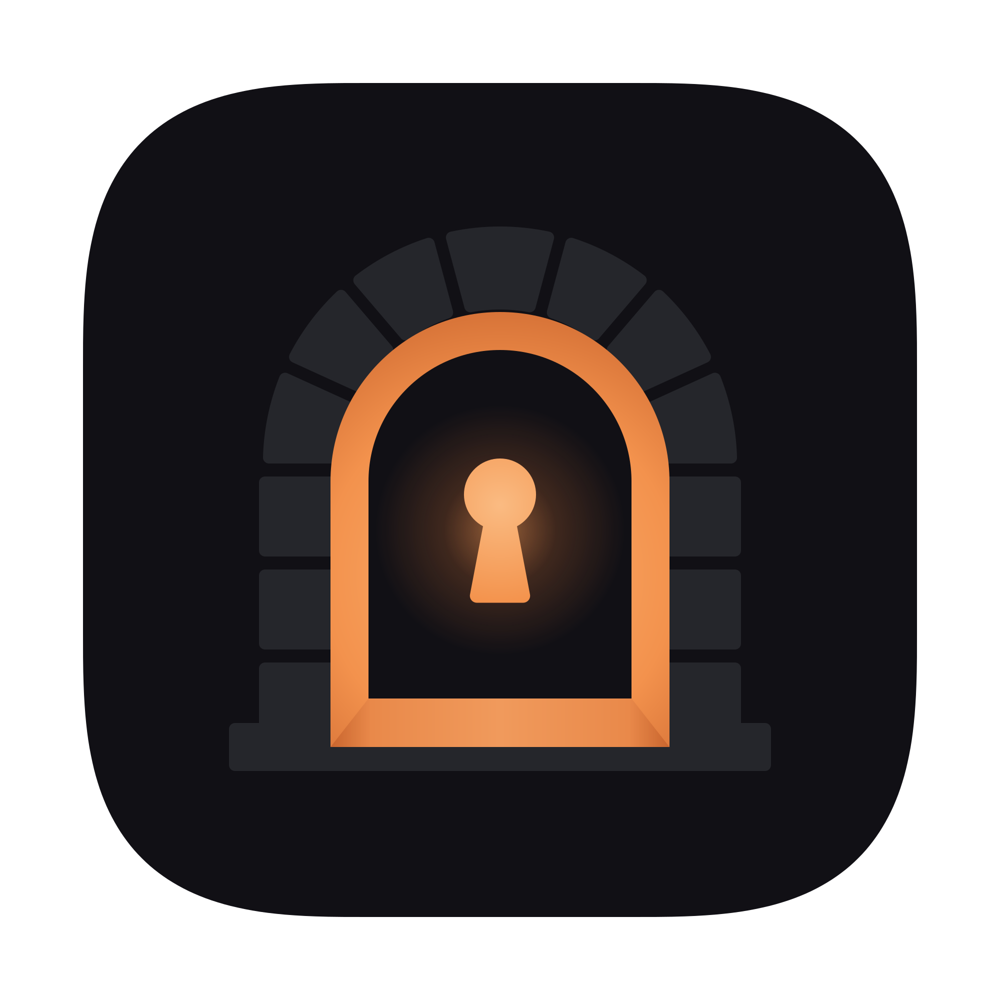
</p>

# Mahzen

**An encrypted, portable vault for your files, notes and passwords.**

<p align="center">
  <a href="https://mahzen.efef.dev/en/"><b>🌐 mahzen.efef.dev</b></a>
  &nbsp;·&nbsp; <a href="#installation">Installation</a>
  &nbsp;·&nbsp; <a href="linux/README.en.md">Linux</a>
  &nbsp;·&nbsp; <a href="SECURITY.en.md">Security</a>
</p>

<p align="center">
  <a href="https://mahzen.efef.dev/en/">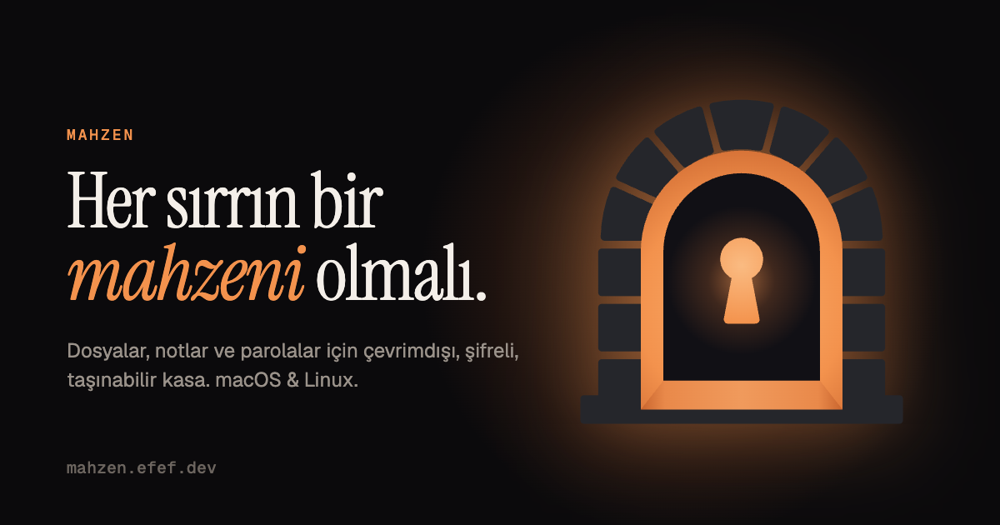</a>
</p>

The quickest way to see how Mahzen works is the **[website](https://mahzen.efef.dev/en/)**: the encryption explained
in numbers, a short tour of the app, the self-wipe feature and how macOS and Linux share the same vault, all on a
single page. The details, installation and security limitations are in this README.

Mahzen (Turkish for "cellar") is a local macOS and Linux app that keeps your files, notes and passwords in a single encrypted folder. The app and the vault can sit side by side on an SSD; the same vault opens on any Mac and any Linux computer. Nothing is sent to the internet, and no account is needed.

> 🐧 **Linux version:** in the [`linux/`](linux/) folder (GTK 4 + libadwaita). It uses the same vault format as macOS; one vault can be opened and edited on both systems. Install: `cd linux && ./install.sh` — details in [linux/README.en.md](linux/README.en.md).

<p align="center">
  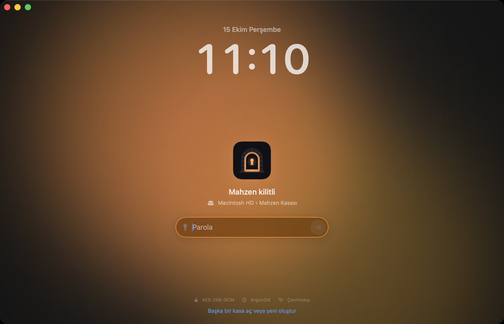
  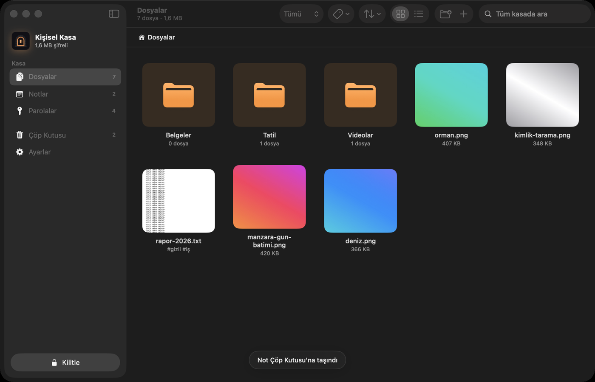
</p>
<p align="center">
  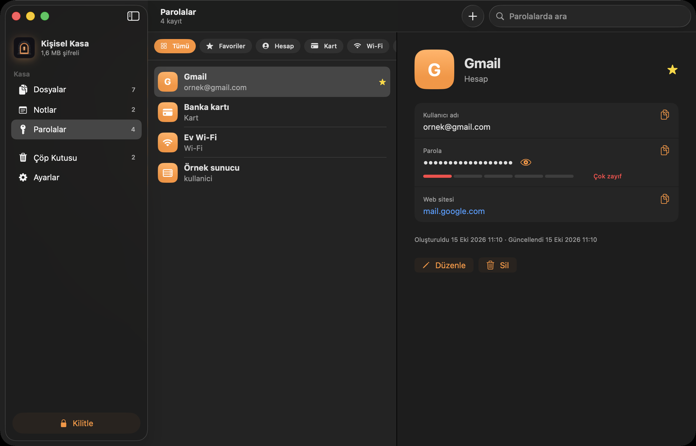
  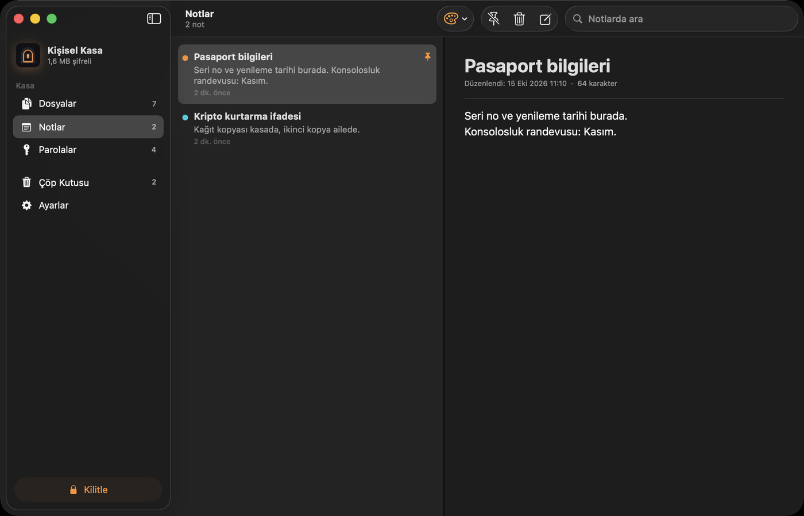
</p>

**Linux version** (GTK 4 + libadwaita):

<p align="center">
  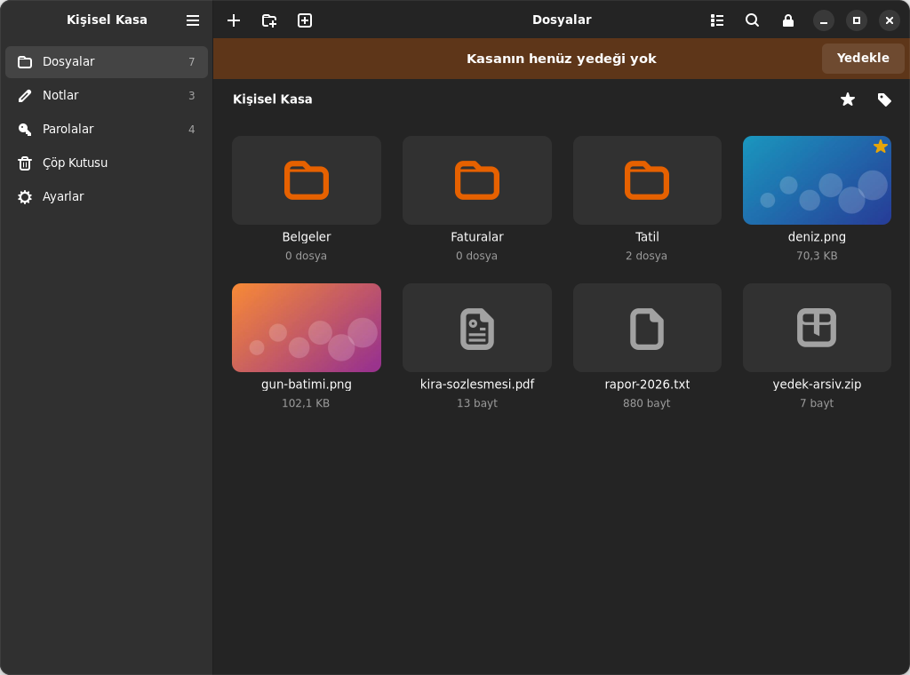
  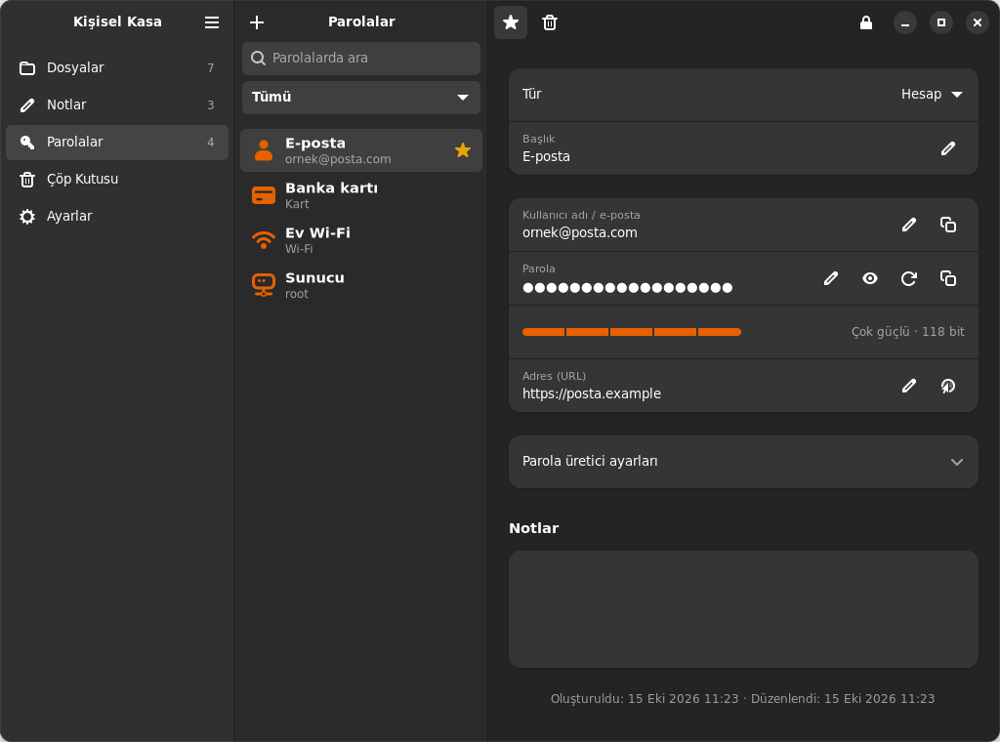
</p>

## Features

**Files**
- Add by drag and drop; the structure of dropped folders is preserved
- Nested folders inside the vault, tags, favorites, search and filters
- Preview images, PDFs and text inside the app
- Play video and audio **without writing an unencrypted copy to disk** (decrypted in memory, chunk by chunk)
- Export by dragging to Finder; the same file is never added twice
- Option to move the originals to the Mac's Trash after adding

**Notes and passwords**
- Colored, pinnable notes; adjustable font and size
- Account, card, Wi-Fi and server entries; password generator and strength meter
- A copied password is automatically cleared from the clipboard after the time you choose

**Security and maintenance**
- Auto-lock when idle, on sleep, on screen lock and when the SSD is unplugged
- Optional: a **keyfile** that ties the vault to a Mac (password + a random file stored on that Mac)
- Optional: a **wrong-password limit** — after a set number of consecutive wrong passwords (5 by default, adjustable from 3 to 99) the vault is permanently erased ([details](#wrong-password-limit))
- Hide the window from screenshots, recordings and screen sharing
- Trash (adjustable retention), one-click incremental backup, backup reminder
- Integrity check: verifies every file by decrypting it and restores corrupted ones from the backup

**Appearance**
- An orange-and-black look that matches the logo by default; light / dark / system theme and 9 accent colors (including the old indigo); grid or list view
- Lock screen with a clock, Caps Lock warning
- Interface language: System / Türkçe / English, chosen in Settings (if the system language isn't Turkish, the app opens in English)

## How does the encryption work?

| Layer | Method |
|---|---|
| Data encryption | **AES-256-GCM** (Apple CryptoKit). Each file is encrypted with its own key, in 1 MB chunks. |
| Key from password | **Argon2id** — 1 GB memory, 3 passes, 4 threads (in a release build on Apple Silicon, ~0.7 s per attempt). Makes bulk guessing on GPUs expensive. |
| Key hierarchy | A random 256-bit master key is wrapped with the key derived from the password. File, thumbnail and index keys are derived from the master key with HKDF-SHA256. |
| Keyfile (optional) | Wrapping key = HKDF(Argon2id(password) ‖ 512-bit random file). The vault header has no field that reveals a keyfile is in use. |
| Integrity | The order of the chunks and the "last chunk" flag are bound to the nonce; files that have been modified, reordered, truncated or appended to are rejected, including during the player's random-access reads. |

The vault folder contains only randomly named encrypted files; **file names, folders, tags, notes and passwords are encrypted too.**

```
Mahzen Kasası/
├── vault.json        unencrypted header: salt, Argon2id settings, wrapped master key, wrong-password limit and counter (no secrets)
├── index.enc         encrypted index (+ index.enc.bak: the previous version)
├── blobs/xx/<id>.mhz encrypted file contents
└── thumbs/<id>.mhz   encrypted thumbnails
```

The app uses no public-key cryptography (RSA/ECC), so it has no component of the kind quantum computers can break. Grover's algorithm reduces the effective strength of AES-256 to roughly 128 bits, which is still considered unbreakable in practice. No algorithm, however, can save a weak password.

### Wrong-password limit

Turned on and off under **Settings → Wrong-password limit**; the number of attempts can be set between 3 and 99 (5 when first enabled). While it is on:

<p align="center">
  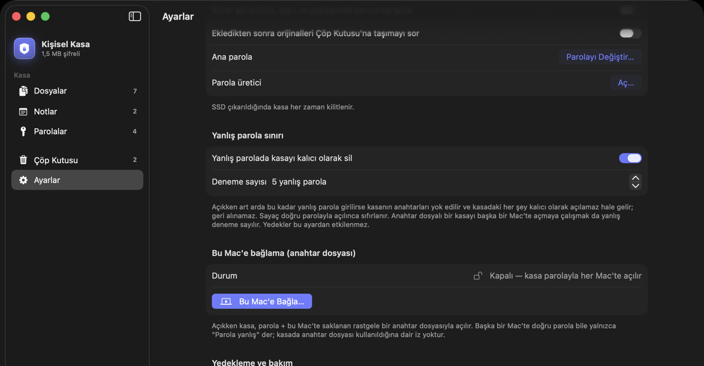
</p>
<p align="center">
  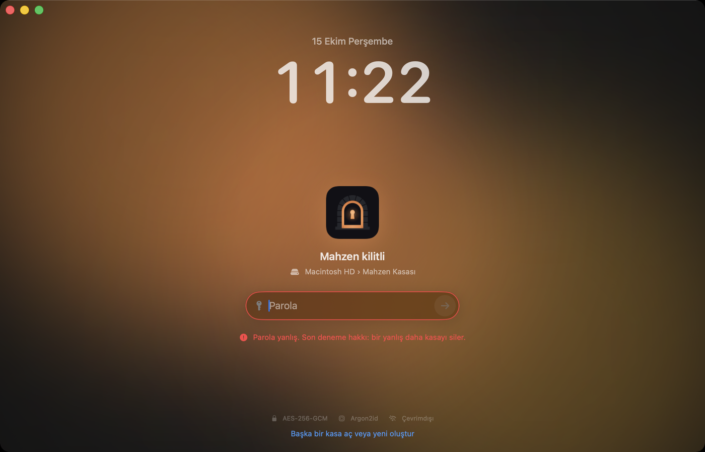
  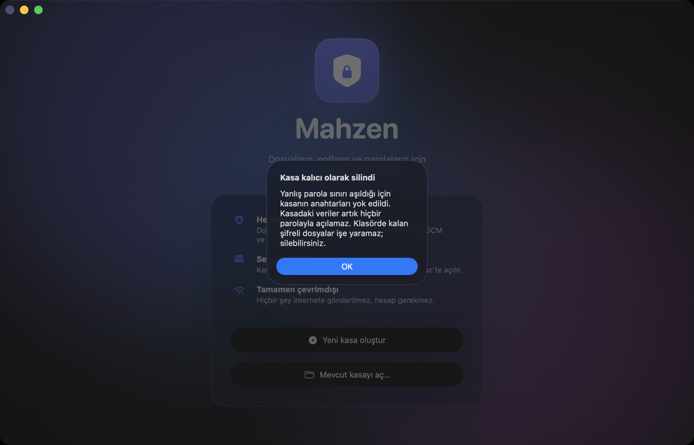
</p>

- Every wrong password on the lock screen is counted, and the number of attempts left is shown. Unlocking with the right password resets the counter.
- When the limit is reached, `vault.json` (and `vault.json.bak`, if present), which holds the vault's wrapped master key, is overwritten with random bytes and deleted. Since the master key exists nowhere else, the files, notes and passwords in the vault **can never be opened again, not even with the right password; this cannot be undone.** The encrypted files left in the folder become useless.
- The setting is shared by the macOS and Linux versions (it lives in the vault header); `mahzen-cli` counts attempts too.

This feature protects against someone trying passwords on the lock screen. What you should know:

- The setting and the counter live in the unencrypted header so they can be read while the vault is locked. Someone who copied the vault folder beforehand, or who edits `vault.json` by hand, is not affected by the counter; the real protection against that kind of attack is a strong password and Argon2id.
- Backups you have already made still open with their own headers (which can also serve as a safety net).
- Trying to open a keyfile-protected vault on a computer that doesn't have the keyfile also counts as a wrong attempt.
- On SSDs, a physical copy of the overwritten bytes may linger in the drive controller for a while.

### Limitations — please read

- **It has not been through an independent security audit.** The building blocks (CryptoKit, the Argon2 reference implementation) are audited libraries, but the Mahzen code that combines them is not. For data of critical importance, consider audited tools such as VeraCrypt or Cryptomator.
- **Security depends on the strength of your password.** 5+ randomly chosen words or 12+ random characters are recommended.
- **If the password is forgotten, the data cannot be recovered.** If you use a keyfile, back that up as well.
- File **sizes and counts** are visible to anyone who looks at the vault folder.
- "Open Temporarily" and dragging to Finder create unencrypted copies outside the vault (cleaned up on lock and at the next launch).
- Someone who can write to the vault folder can replace the index file with an older copy and roll notes/passwords back to an earlier state; this is not detected yet.
- Changing the password or adding a keyfile does not renew the master key; an old copy of the header plus the old password is enough to open the data.

## Installation

> For Linux: [linux/README.en.md](linux/README.en.md)

### Prebuilt app
Will be added to the [Releases](../../releases) page. For now, build from source.

### Building from source

Requirements: macOS 14+, **full Xcode 15.3 or later** (Swift 5.10+; because Apple Silicon + Intel are built into a single package, the Command Line Tools alone are not enough)

```bash
git clone https://github.com/efefdev/Mahzen.git
cd Mahzen
./scripts/build-app.sh      # dist/Mahzen.app (Apple Silicon + Intel)
```

To move the app to an SSD, copy the `dist/Mahzen.app` folder to the root of the SSD. On first launch the vault is created next to the app as `Mahzen Kasası`.

The app is ad-hoc signed (not notarized by Apple). A copy you built yourself opens without a warning. If macOS warns you when opening a copy downloaded from the internet:
- **macOS 15 and later:** Try to open it first, then use the **"Open Anyway"** button at the bottom of **System Settings → Privacy & Security**.
- **macOS 14:** Right-click in Finder → **Open**.

### Tests

```bash
swift test
```

44 tests covering encryption, chunk verification, tamper/truncation detection, the Argon2 reference test vectors, keyfiles (including archiving), the import plan, backup and the integrity check. `LinuxCompatibilityTests` opens a vault created with the Linux version to verify that the two versions speak the same format.

Tests for the Linux core: `python3 -m unittest discover -s linux/tests`

## Project layout

```
Sources/
├── CArgon2/      The official Argon2 reference implementation (unmodified, CC0/Apache-2.0)
├── MahzenCore/   Encryption, vault format, backup, integrity check (UI-independent)
└── Mahzen/       SwiftUI app
Tests/            Core tests
scripts/          App packaging and icon generation
linux/            Linux app (Python, GTK 4 + libadwaita) and the Python core for the same vault format
site/             Website (mahzen.efef.dev); published to GitHub Pages automatically when it lands on main
```

## Roadmap

- [x] **Linux app** ([linux/](linux/))
- [ ] Prebuilt releases
- [ ] Markdown notes, attaching files to notes
- [ ] Password health screen (weak / reused passwords)
- [ ] ⌘K quick search, menu bar icon

## License

Mahzen is released under the **[PolyForm Noncommercial 1.0.0](LICENSE)** license. The source code is open; you may use, study, modify and share it for any **noncommercial** purpose.

| ✅ Allowed | ❌ Requires permission |
|---|---|
| Personal use, learning, research, experimentation | Selling it, or including it in a paid service or product |
| Use in schools, associations and nonprofit organizations | Using it in a company's commercial activity |
| Modifying and sharing it for noncommercial purposes (with the license text and copyright notice) | |

For commercial use, get in touch via GitHub.

> Note: Because it restricts commercial use, this license is not "open source" by the OSI definition; it is a **source-available** license.

The Argon2 code under `Sources/CArgon2` is distributed under its own license (CC0 1.0 or Apache 2.0); see [Sources/CArgon2/LICENSE](Sources/CArgon2/LICENSE) for details.
