<p align="center">
  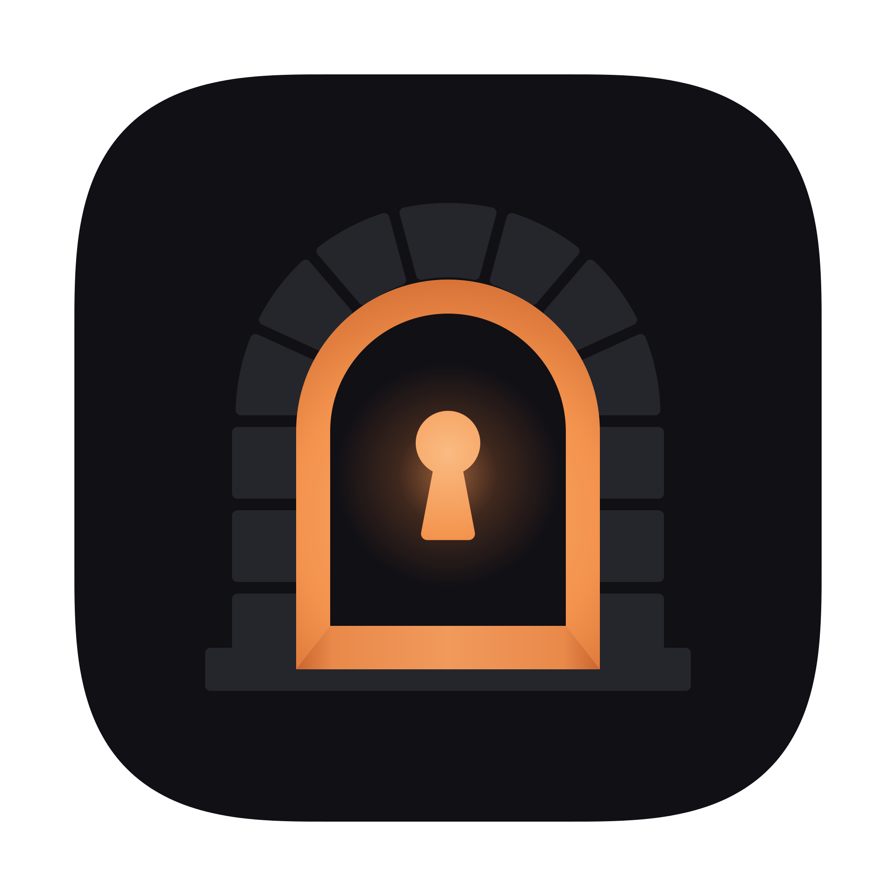
</p>

# Mahzen

**Dosyaların, notların ve parolaların için şifreli, taşınabilir bir kasa.**

<p align="center">
  <a href="https://mahzen.efef.dev"><b>🌐 mahzen.efef.dev</b></a>
  &nbsp;·&nbsp; <a href="#kurulum">Kurulum</a>
  &nbsp;·&nbsp; <a href="linux/README.md">Linux</a>
  &nbsp;·&nbsp; <a href="SECURITY.md">Güvenlik</a>
</p>

<p align="center">
  <a href="https://mahzen.efef.dev">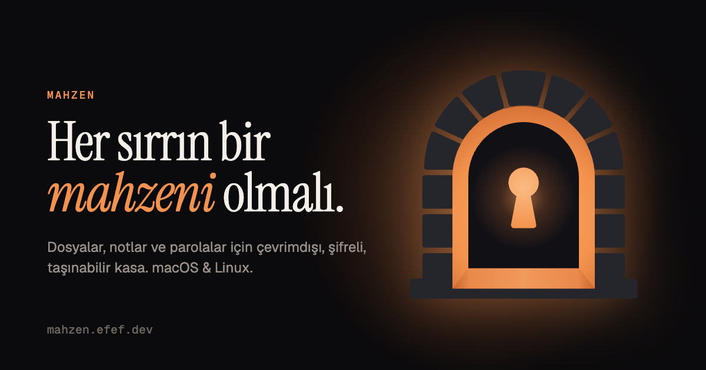</a>
</p>

Mahzen'in nasıl çalıştığını görmenin en kısa yolu **[tanıtım sitesi](https://mahzen.efef.dev)**: şifrelemenin
rakamlarla anlatımı, uygulamanın kısa bir turu, kendini silme özelliği ve macOS ile Linux'un aynı kasayı nasıl
paylaştığı tek sayfada. Ayrıntılar, kurulum ve güvenlik sınırları bu README'de.

Mahzen; dosyalarını, notlarını ve parolalarını tek bir şifreli klasörde saklayan yerel bir macOS ve Linux uygulamasıdır. Uygulama ile kasa yan yana bir SSD'de durabilir; aynı kasa her Mac'te ve her Linux bilgisayarda açılabilir. İnternete hiçbir şey gönderilmez, hesap gerekmez.

> 🐧 **Linux sürümü:** [`linux/`](linux/) klasöründe (GTK 4 + libadwaita). macOS ile aynı kasa biçimini kullanır; bir kasa iki sistemde de açılır ve düzenlenir. Kurulum: `cd linux && ./install.sh` — ayrıntılar [linux/README.md](linux/README.md)'de.

<p align="center">
  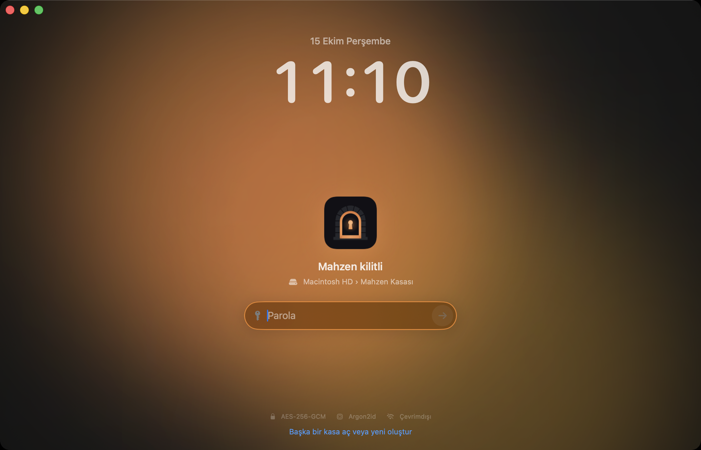
  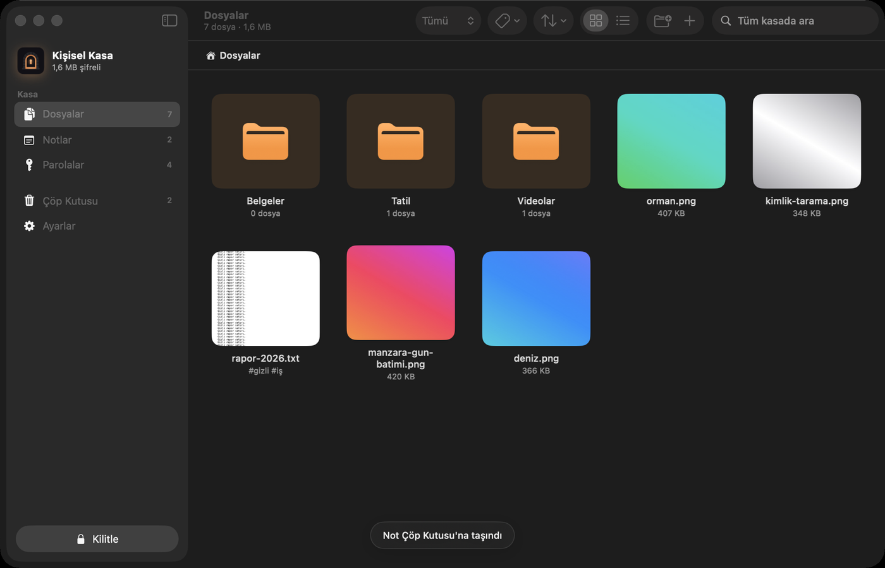
</p>
<p align="center">
  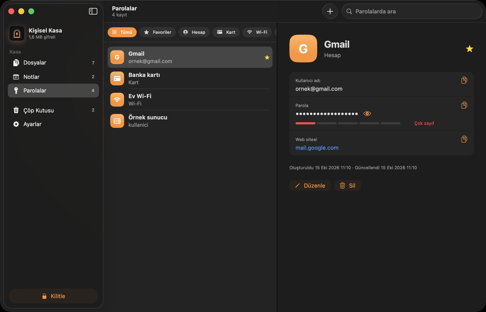
  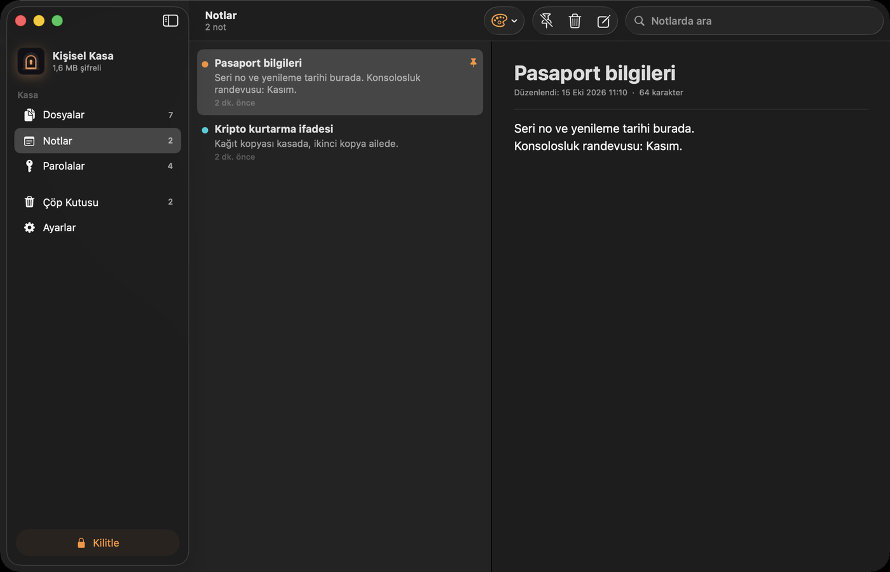
</p>

**Linux sürümü** (GTK 4 + libadwaita):

<p align="center">
  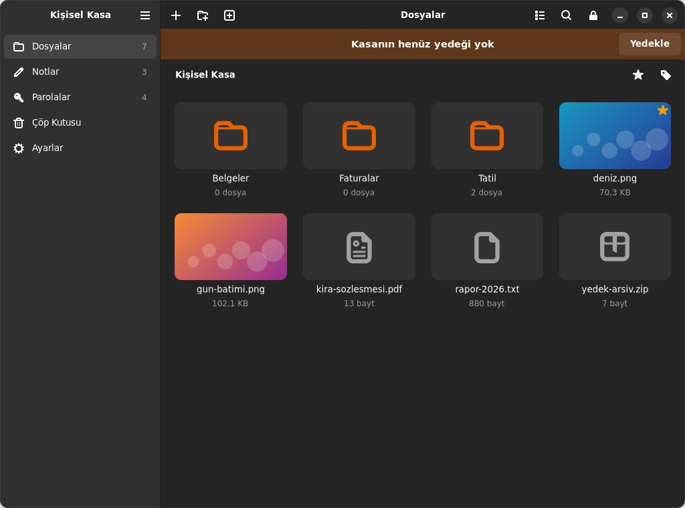
  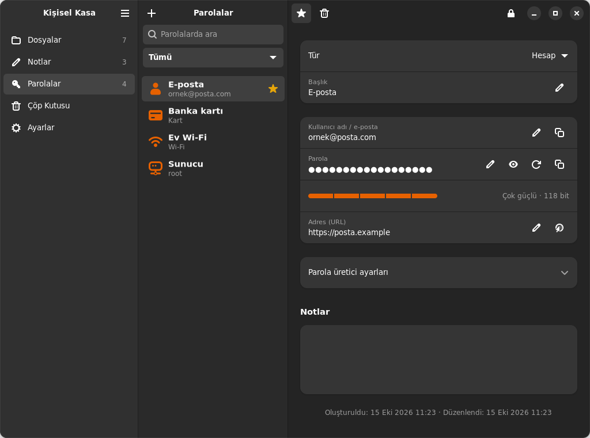
</p>

## Özellikler

**Dosyalar**
- Sürükle-bırak ile ekleme; sürüklenen klasörlerin yapısı korunur
- Kasa içinde iç içe klasörler, etiketler, favoriler, arama ve filtreler
- Görsel, PDF ve metinleri uygulama içinde önizleme
- Video ve sesleri **diske şifresiz kopya yazmadan** oynatma (şifre bellekte, parça parça çözülür)
- Finder'a sürükleyerek dışa aktarma, aynı dosyanın iki kez eklenmesini önleme
- Ekledikten sonra orijinalleri Mac'in Çöp Kutusu'na taşıma seçeneği

**Notlar ve parolalar**
- Renkli, sabitlenebilir notlar; yazı tipi ve boyutu ayarlanabilir
- Hesap, kart, Wi-Fi ve sunucu kayıtları; parola üretici ve güç ölçer
- Kopyalanan parola, seçilen süre sonunda panodan otomatik silinir

**Güvenlik ve bakım**
- Hareketsizlikte, uykuda, ekran kilidinde ve SSD çıkarıldığında otomatik kilit
- İsteğe bağlı: kasayı bir Mac'e bağlayan **anahtar dosyası** (parola + o Mac'te saklanan rastgele dosya)
- İsteğe bağlı: **yanlış parola sınırı** — art arda belirli sayıda (varsayılan 5, 3–99 arası ayarlanabilir) yanlış parola girilirse kasa kalıcı olarak silinir ([ayrıntılar](#yanlış-parola-sınırı))
- Pencereyi ekran görüntüsü, kayıt ve ekran paylaşımında gizleme
- Çöp Kutusu (ayarlanabilir süre), tek tıkla artımlı yedek, yedek hatırlatması
- Bütünlük taraması: her dosyayı çözerek doğrular, bozuk olanları yedekten geri yükler

**Görünüm**
- Varsayılan olarak logoyla uyumlu turuncu-siyah görünüm; açık / koyu / sistem teması ve 9 vurgu rengi (eski çivit dahil) seçilebilir; ızgara veya liste görünümü
- Saatli kilit ekranı, Caps Lock uyarısı, Türkçe arayüz

## Şifreleme nasıl çalışıyor?

| Katman | Yöntem |
|---|---|
| Veri şifreleme | **AES-256-GCM** (Apple CryptoKit). Her dosya kendi anahtarıyla, 1 MB'lık parçalar halinde şifrelenir. |
| Paroladan anahtar | **Argon2id** — 1 GB bellek, 3 geçiş, 4 iş parçacığı (release derlemede, Apple Silicon'da deneme başına ~0,7 sn). Ekran kartıyla toplu tahmini pahalılaştırır. |
| Anahtar hiyerarşisi | Rastgele 256 bitlik ana anahtar, paroladan türetilen anahtarla sarılır. Dosya, küçük resim ve dizin anahtarları ana anahtardan HKDF-SHA256 ile türetilir. |
| Anahtar dosyası (isteğe bağlı) | Sarma anahtarı = HKDF(Argon2id(parola) ‖ 512 bit rastgele dosya). Kasa başlığında anahtar dosyasına dair hiçbir alan yoktur. |
| Bütünlük | Parçaların sırası ve "son parça" bilgisi nonce'a bağlıdır; değiştirilen, yer değiştirilen, kesilen veya sonuna veri eklenen dosyalar — oynatıcının rastgele erişimli okumasında da — reddedilir. |

Kasa klasöründe yalnızca rastgele adlı şifreli dosyalar bulunur; **dosya adları, klasörler, etiketler, notlar ve parolalar da şifrelidir.**

```
Mahzen Kasası/
├── vault.json        şifresiz başlık: tuz, Argon2id ayarları, sarılmış ana anahtar, yanlış parola sınırı ve sayacı (sır içermez)
├── index.enc         şifreli dizin (+ index.enc.bak: bir önceki sürüm)
├── blobs/xx/<id>.mhz şifreli dosya içerikleri
└── thumbs/<id>.mhz   şifreli küçük resimler
```

Uygulamada açık anahtarlı şifreleme (RSA/ECC) bulunmaz; bu yüzden kuantum bilgisayarların kırabildiği türden bir bileşen yoktur. Grover algoritması AES-256'nın etkin gücünü yaklaşık 128 bite indirir; bu hâlâ pratikte kırılamaz kabul edilir. Zayıf bir parolayı ise hiçbir algoritma kurtaramaz.

### Yanlış parola sınırı

**Ayarlar → Yanlış parola sınırı** bölümünden açılıp kapatılır; deneme sayısı 3 ile 99 arasında seçilir (açılırken 5). Açıkken:

<p align="center">
  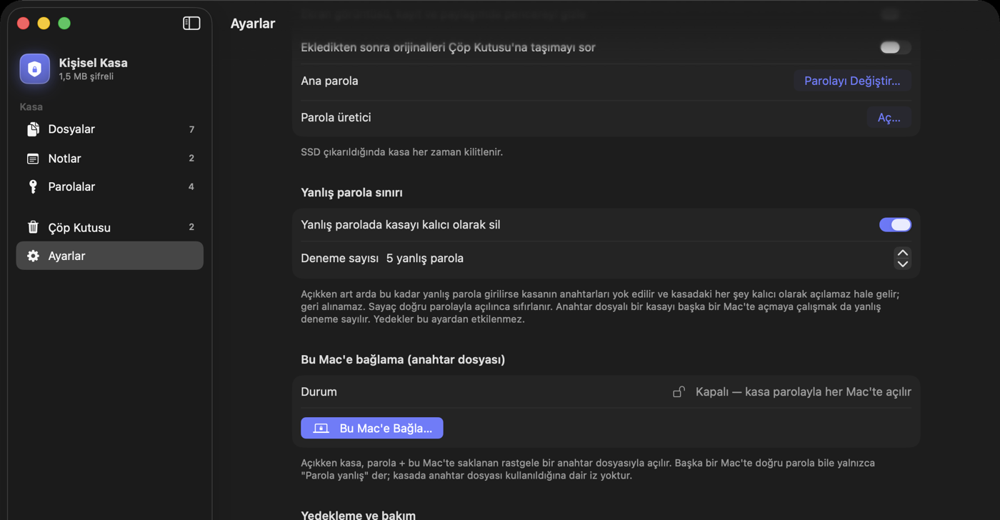
</p>
<p align="center">
  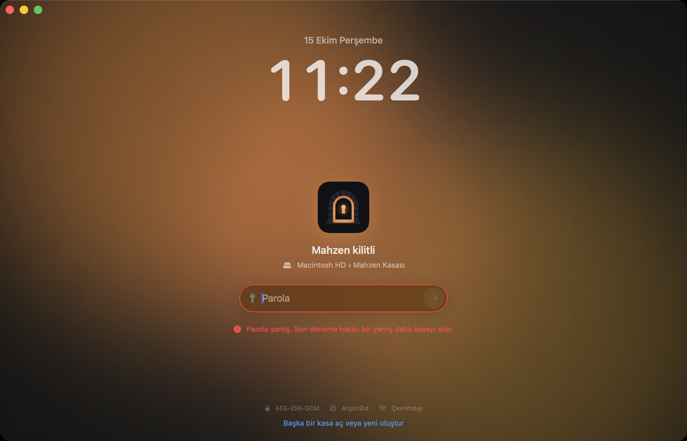
  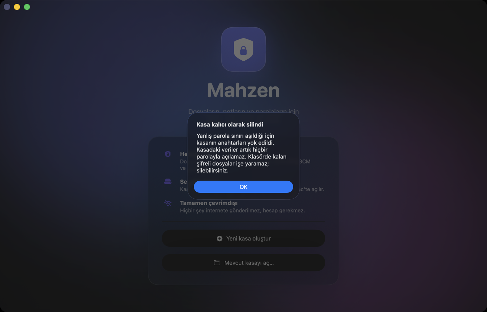
</p>

- Kilit ekranında her yanlış parola sayılır ve kalan deneme hakkı gösterilir. Doğru parolayla açılınca sayaç sıfırlanır.
- Sınıra ulaşıldığında kasanın sarılmış ana anahtarını taşıyan `vault.json` (ve varsa `vault.json.bak`) rastgele baytlarla ezilip silinir. Ana anahtar başka hiçbir yerde olmadığından kasadaki dosyalar, notlar ve parolalar **doğru parolayla bile bir daha açılamaz; geri alınamaz.** Klasörde kalan şifreli dosyalar işe yaramaz hale gelir.
- Ayar macOS ve Linux sürümlerinde ortaktır (kasa başlığında durur); `mahzen-cli` de denemeleri sayar.

Bu özellik kilit ekranında parola deneyen birine karşıdır; bilinmesi gerekenler:

- Ayar ve sayaç kilitliyken okunabilmesi için şifresiz başlıkta durur. Kasa klasörünü önceden kopyalayan ya da `vault.json`'u elle düzenleyen biri sayaçtan etkilenmez; böyle bir saldırıya karşı asıl koruma güçlü parola ve Argon2id'dir.
- Alınmış yedekler kendi başlıklarıyla açılmaya devam eder (bu bir güvence olarak da kullanılabilir).
- Anahtar dosyalı bir kasayı anahtar dosyasının olmadığı bir bilgisayarda açmaya çalışmak da yanlış deneme sayılır.
- SSD'lerde ezilen baytların fiziksel kopyası disk denetleyicisinde bir süre kalabilir.

### Sınırlar — lütfen okuyun

- **Bağımsız güvenlik denetiminden geçmedi.** Kullanılan yapı taşları (CryptoKit, Argon2 referans uygulaması) denetlenmiş kütüphanelerdir; ancak bunları birleştiren Mahzen kodu denetlenmemiştir. Hayati önemde veriler için VeraCrypt veya Cryptomator gibi denetlenmiş araçları değerlendirin.
- **Güvenlik parolanızın gücüne bağlıdır.** Rastgele seçilmiş 5+ kelime veya 12+ rastgele karakter önerilir.
- **Parola unutulursa veriler kurtarılamaz.** Anahtar dosyası kullanılıyorsa onun da yedeği alınmalıdır.
- Dosya **boyutları ve sayısı** kasa klasörüne bakan biri tarafından görülebilir.
- "Geçici Aç" ve Finder'a sürükleme, kasa dışında şifresiz kopya oluşturur (kilitte ve bir sonraki açılışta temizlenir).
- Kasa klasörüne yazabilen biri dizin dosyasını eski bir kopyasıyla değiştirerek notları/parolaları eski hâline döndürebilir; bu henüz tespit edilmiyor.
- Parola değiştirmek veya anahtar dosyası eklemek ana anahtarı yenilemez; eski bir başlık kopyası ile eski parola, verileri açmaya yeter.

## Kurulum

> Linux için: [linux/README.md](linux/README.md)

### Hazır uygulama
[Sürümler](../../releases) sayfasına eklenecek. Şimdilik kaynaktan derleyin.

### Kaynaktan derleme

Gereksinimler: macOS 14+, **tam Xcode 15.3 veya üstü** (Swift 5.10+; Apple Silicon + Intel tek pakette derlendiği için yalnızca Komut Satırı Araçları yetmez)

```bash
git clone https://github.com/efefdev/Mahzen.git
cd Mahzen
./scripts/build-app.sh      # dist/Mahzen.app (Apple Silicon + Intel)
```

Uygulamayı SSD'ye taşımak için `dist/Mahzen.app` klasörünü SSD'nin köküne kopyalayın. İlk açılışta kasa, uygulamanın yanında `Mahzen Kasası` olarak oluşturulur.

Uygulama ad-hoc imzalıdır (Apple tarafından noterize edilmemiştir). Kendi derlediğiniz kopya uyarısız açılır. İnternetten indirilmiş bir kopyayı açarken macOS uyarı verirse:
- **macOS 15 ve sonrası:** Önce açmayı deneyin, sonra **Sistem Ayarları → Gizlilik ve Güvenlik** sayfasının altındaki **"Yine de Aç"** düğmesini kullanın.
- **macOS 14:** Finder'da sağ tık → **Aç**.

### Testler

```bash
swift test
```

44 test; şifreleme, parça doğrulama, kurcalama/kesme tespiti, Argon2 referans test vektörleri, anahtar dosyası (arşivleme dahil), içe aktarma planı, yedekleme ve bütünlük taramasını kapsar. `LinuxCompatibilityTests`, Linux sürümüyle oluşturulmuş bir kasayı açarak iki sürümün aynı biçimi konuştuğunu doğrular.

Linux çekirdeğinin testleri: `python3 -m unittest discover -s linux/tests`

## Proje yapısı

```
Sources/
├── CArgon2/      Argon2 resmi referans uygulaması (değiştirilmeden, CC0/Apache-2.0)
├── MahzenCore/   Şifreleme, kasa biçimi, yedekleme, bütünlük taraması (arayüzden bağımsız)
└── Mahzen/       SwiftUI uygulaması
Tests/            Çekirdek testleri
scripts/          Uygulama paketleme ve simge üretme
linux/            Linux uygulaması (Python, GTK 4 + libadwaita) ve aynı kasa biçiminin Python çekirdeği
site/             Tanıtım sitesi (mahzen.efef.dev); main'e girince GitHub Pages'e otomatik yayınlanır
```

## Yol haritası

- [x] **Linux uygulaması** ([linux/](linux/))
- [ ] Hazır derlenmiş sürümler
- [ ] Markdown notlar, notlara dosya ekleme
- [ ] Parola sağlığı ekranı (zayıf / tekrar kullanılan parolalar)
- [ ] ⌘K hızlı arama, menü çubuğu simgesi

## Lisans

Mahzen, **[PolyForm Noncommercial 1.0.0](LICENSE)** lisansıyla yayımlanır. Kaynak kodu açıktır; **ticari olmayan** her amaçla kullanabilir, inceleyebilir, değiştirebilir ve paylaşabilirsiniz.

| ✅ Serbest | ❌ İzin gerektirir |
|---|---|
| Kişisel kullanım, öğrenme, araştırma, deneme | Satmak, ücretli hizmete veya ürüne dahil etmek |
| Okul, dernek, kâr amacı gütmeyen kuruluşlarda kullanım | Bir şirketin ticari faaliyetinde kullanmak |
| Değiştirip ticari olmayan amaçla paylaşmak (lisans metni ve telif bildirimiyle) | |

Ticari kullanım için GitHub üzerinden iletişime geçin.

> Not: Ticari kullanımı kısıtladığı için bu lisans, OSI tanımına göre "açık kaynak" değil, **kaynağı açık (source-available)** bir lisanstır.

`Sources/CArgon2` altındaki Argon2 kodu kendi lisansıyla (CC0 1.0 veya Apache 2.0) dağıtılır; ayrıntılar için [Sources/CArgon2/LICENSE](Sources/CArgon2/LICENSE) dosyasına bakın.
