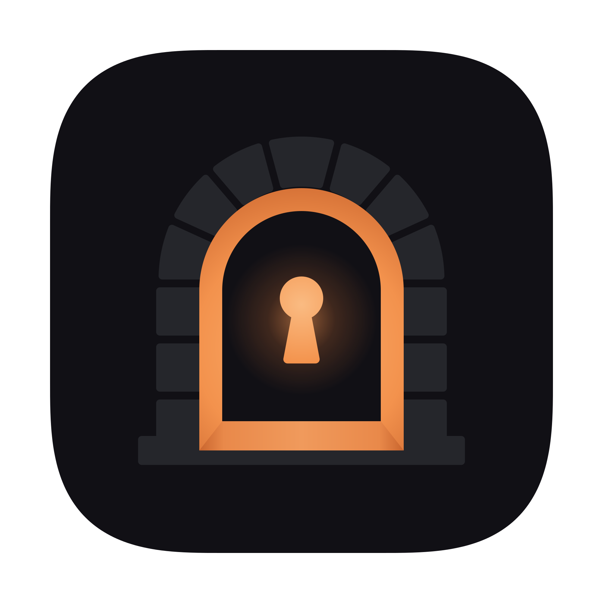
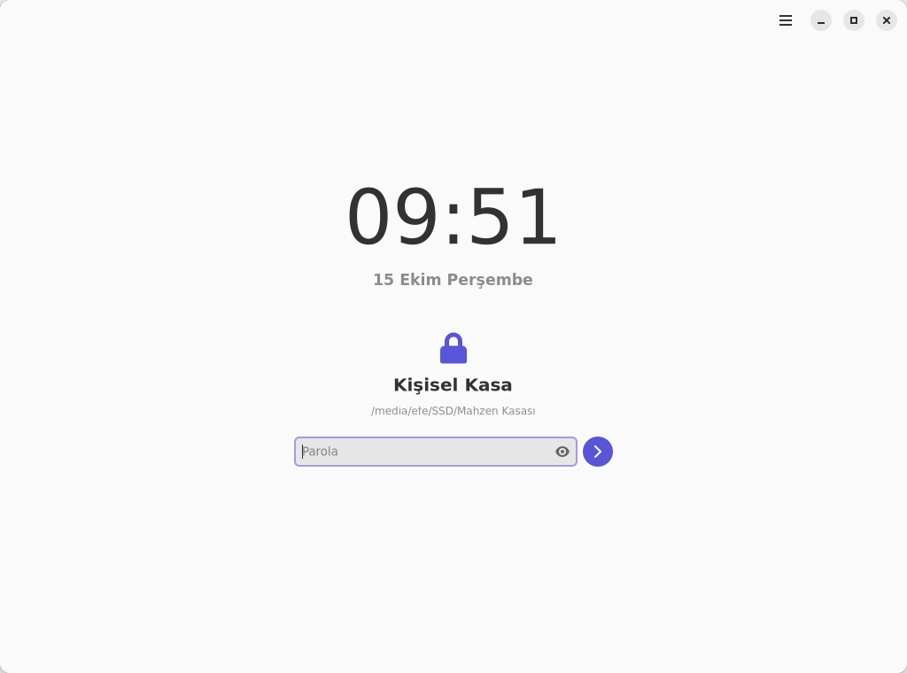
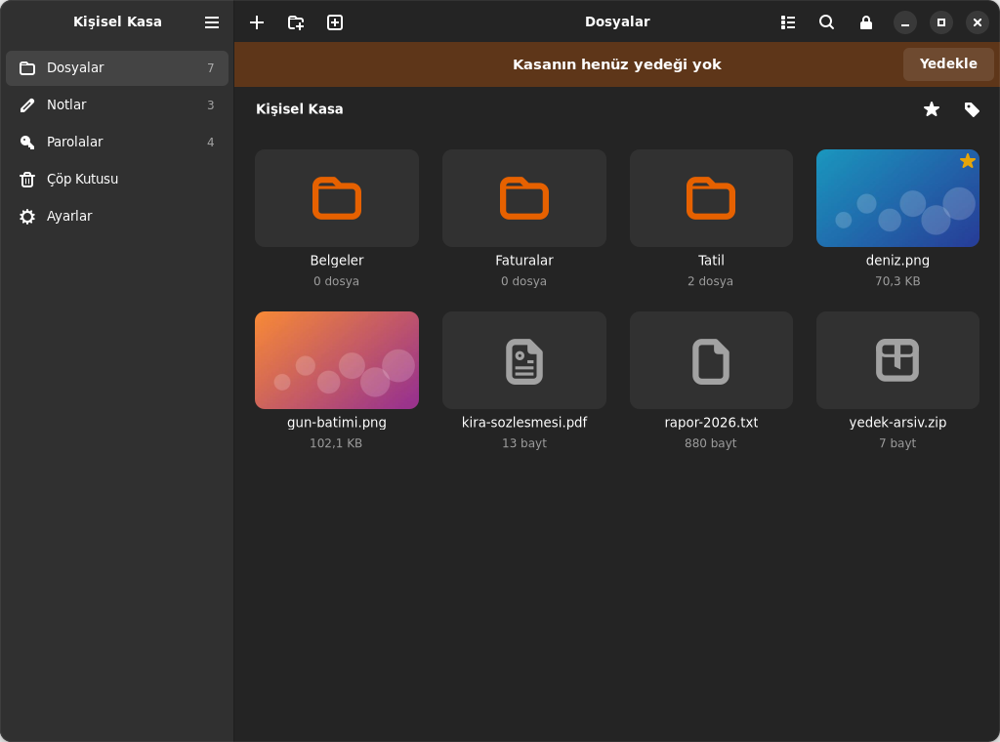
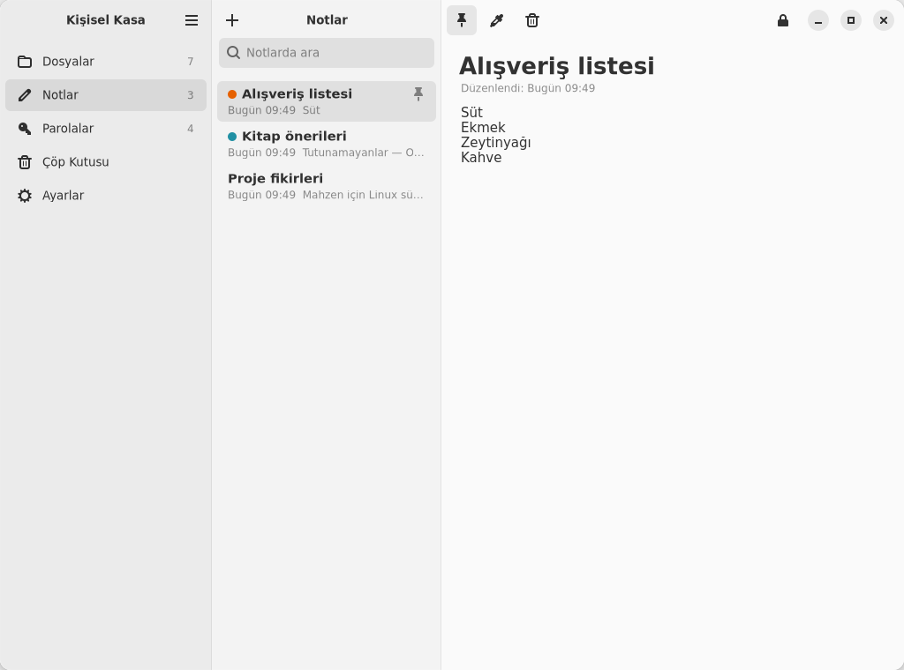
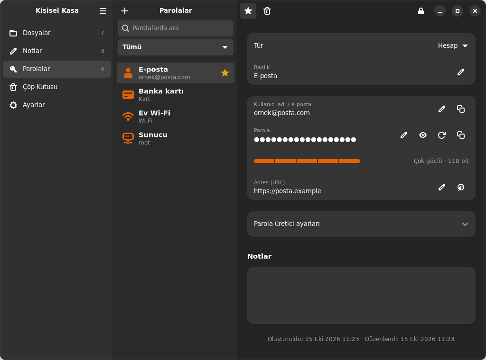
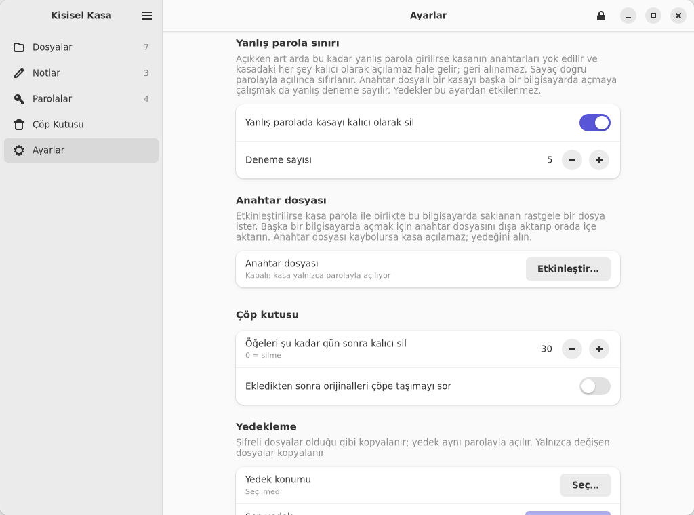
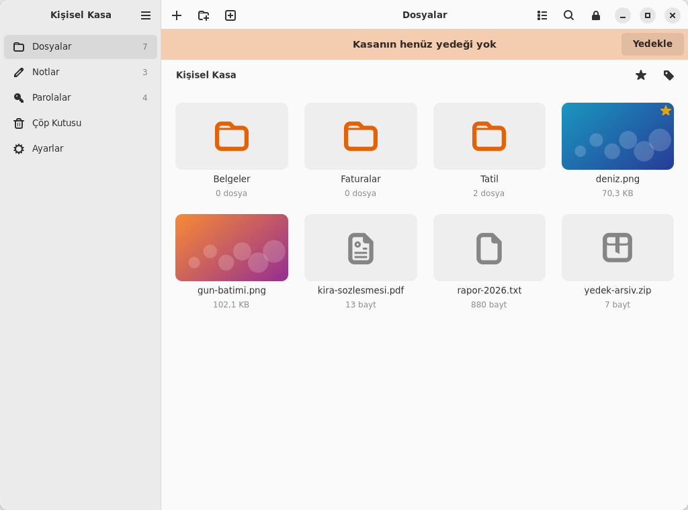

[Türkçe](README.md) · **English**

# Mahzen — Linux version

The Linux app for Mahzen: a GTK 4 + libadwaita interface with an encryption core written in Python.
**It uses the same vault format as the macOS version.** A `Mahzen Kasası` folder on an SSD opens on both a Mac and
Linux; both apps can add files, notes and passwords to the same vault.

<p align="center">
  
</p>

<p align="center">
  
  
</p>
<p align="center">
  
  
</p>
<p align="center">
  
  
</p>

## Installation

Requirements: Python 3.10+, GTK 4, **libadwaita 1.5+**, PyGObject, `cryptography`, `argon2-cffi`.
On Ubuntu 24.04+, Debian 13+, Fedora 40+, Arch and openSUSE Tumbleweed, all of these are available as distribution packages.

```bash
git clone https://github.com/efefdev/Mahzen.git
cd Mahzen/linux
./install.sh
```

`install.sh` installs the dependencies with the distribution's package manager (apt, dnf, pacman, zypper) and places
the app under `~/.local`; the administrator password is requested only for the dependencies. After that Mahzen appears
in the application menu and can also be started from a terminal with `mahzen`. If the dependencies are already
installed: `./install.sh --no-deps`. To remove it, run `./uninstall.sh` (it does not touch vaults or keyfiles).

### Running from a disk without installing (portable)

```bash
./mahzen.sh
```

`mahzen.sh` looks for the vault under the name `Mahzen Kasası` in its own folder or one folder up. That makes a layout
like this possible at the root of an SSD:

```
SSD/
├── Mahzen.app        macOS app
├── Mahzen-Linux/     a copy of this folder (linux/) → ./mahzen.sh
└── Mahzen Kasası/    shared encrypted vault
```

The Linux computer only needs the dependencies installed (the distribution's packages instead of `./install.sh`).

## Features

Most of the features of the macOS version are available on Linux too:

- **Files:** add by drag and drop or with the file chooser (folder structure is preserved), nested folders, tags,
  favorites, search, grid/list view, move by dragging inside the vault, image and text preview,
  temporary opening, export, duplicate detection, an offer to move the originals to the trash after adding
- **Notes:** colored, pinnable notes; adjustable font and size
- **Passwords:** account, card, Wi-Fi and server entries; password generator and strength meter; a copied password is
  cleared from the clipboard after the time you choose
- **Security:** auto-lock when idle, on sleep, when the screen locks and when the vault's disk is removed;
  optional keyfile; optional **wrong-password limit** (after N consecutive wrong passwords the vault is permanently
  erased; turned on and off in Settings, 3–99 attempts; details in the main [README](../README.en.md#wrong-password-limit));
  upgrading old (PBKDF2) vaults to Argon2id when they are opened
- **Maintenance:** trash (adjustable retention), incremental backup and reminder, integrity check and restore from backup
- **Appearance:** orange-and-black by default; light / dark / system theme, 9 accent colors (settings are stored in the vault and shared by both systems)
- **Language:** System / Türkçe / English, chosen in Settings (if the system language isn't Turkish, the app opens in English)

### Linux-specific differences

| Topic | On Linux |
|---|---|
| Video and audio | Not played inside the app; opened in the system's player with "Open Temporarily". |
| PDF and document preview | Likewise, through temporary opening. In-app preview is for images and text files. |
| Thumbnails | Generated for images only (macOS also generates them for PDFs/videos). |
| Temporary opening | The unencrypted copy is written under `$XDG_RUNTIME_DIR` (per-session, in memory on most systems); it is deleted on lock and on exit. |
| Hiding from screenshots | Apps cannot prevent this on Wayland/X11; the setting has no effect on Linux. |
| Keyfiles | `~/.local/share/Mahzen/Anahtarlar` (permissions 700/600). To bring over a keyfile from a Mac, use "Export" on the Mac and "Import Keyfile" from the menu on the Linux lock screen. |

## Trying it out (after the first install)

Start with **a new vault made for testing**, not your real one:

1. `mahzen` → **Create New Vault** → pick a location such as `~/Mahzen Test` and set a password.
   Creating the vault takes a few seconds (Argon2id uses 1 GB of memory).
2. **Files:** drag and drop a few images and a folder, or add them with `+`. Thumbnails should appear and the
   folder structure should be preserved. Double-click an image and a `.txt` file to preview them; try
   **Open Temporarily** on one and **Export** on another.
3. **Notes and Passwords:** add a note and a password entry; try the password generator and **Copy**
   (the copied password should be cleared from the clipboard after 30 s).
4. **Lock:** lock with `Ctrl+L`, then enter a wrong password followed by the right one. It should also lock on screen lock/sleep.
5. **Wrong-password limit:** go to Settings → *Wrong-password limit*, turn it on, set the number of attempts to 3,
   lock, and enter a wrong password 3 times: the vault should be permanently erased. (Only do this on the test vault!)
6. **Shared vault with macOS (optional):** select a vault created on a Mac (e.g. the `Mahzen Kasası` on the SSD) with
   **Open Another Vault…** from the menu on the lock screen; the files, notes and passwords from the Mac should
   show up. A file you add on Linux should show up on the Mac too.
7. **Backup and maintenance:** choose a backup location in Settings and click **Back Up Now**, then run the **Integrity check**.

If you run into a problem, start the app from a terminal with `mahzen` and
[open an issue](https://github.com/efefdev/Mahzen/issues) with the output attached.

## Command line

For headless servers there is `mahzen-cli` (without installing: `./mahzen.sh cli`):

```bash
mahzen-cli info   "/media/ssd/Mahzen Kasası"              # header info, no password needed
mahzen-cli list   "/media/ssd/Mahzen Kasası"
mahzen-cli export "/media/ssd/Mahzen Kasası" invoice.pdf ~/Downloads
mahzen-cli add    "/media/ssd/Mahzen Kasası" document.pdf Photos/
mahzen-cli verify "/media/ssd/Mahzen Kasası"
mahzen-cli backup "/media/ssd/Mahzen Kasası" "/media/backup/Mahzen Kasası Backup"
```

The password is asked for every time (it can be read from standard input with `--password-stdin`); if a keyfile is needed,
pass `--keyfile file.mahzenkey`. If the wrong-password limit is on, wrong attempts on the command line are counted too.
The Turkish command and option names (`bilgi`, `listele`, `disari`, `ekle`, `dogrula`, `yedekle`, `--parola-stdin`,
`--anahtar`) work in either language.

## Encryption

The core is identical to `MahzenCore` on macOS (details in the main [README](../README.en.md)):
AES-256-GCM (`cryptography`/OpenSSL), Argon2id 1 GB · 3 passes · 4 threads (`argon2-cffi`, the official Argon2
implementation), HKDF-SHA256 subkeys, nonces bound to 1 MB chunks. Passwords are normalized to Unicode NFC;
passwords with Turkish characters produce the same key on both systems.

Fields in the index JSON that this version doesn't recognize (including fields macOS may add in the future) are read and written back unchanged.

## Tests

```bash
python3 -m unittest discover -s linux/tests
```

The vaults under `tests/fixtures/` were created with the macOS version (Argon2id, keyfile-protected and old PBKDF2
vaults); the tests verify that the Linux version can open them. In the other direction, `tests/fixtures/python-vault`
is created with this version, and `swift test` on the macOS side (LinuxCompatibilityTests) opens it. If the format changes:
`python3 linux/tests/make_python_fixture.py`.

## Project layout

```
linux/
├── mahzen/core/   encryption, vault format, index operations, backup (UI-independent)
├── mahzen/ui/     GTK 4 / libadwaita interface
├── mahzen/cli.py  command line
├── data/          icons and the .desktop file
├── tests/         core and compatibility tests
├── install.sh, uninstall.sh, mahzen.sh
```
