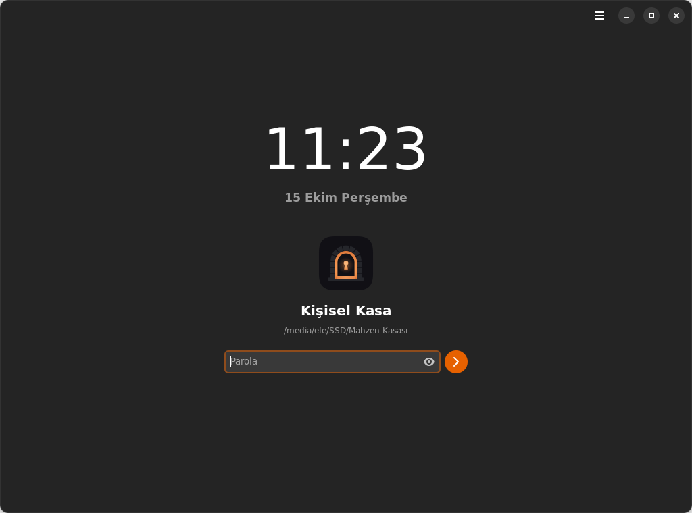
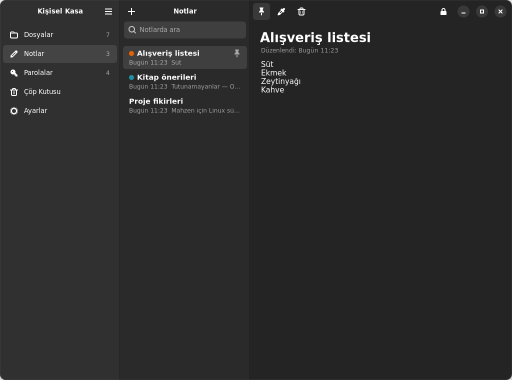
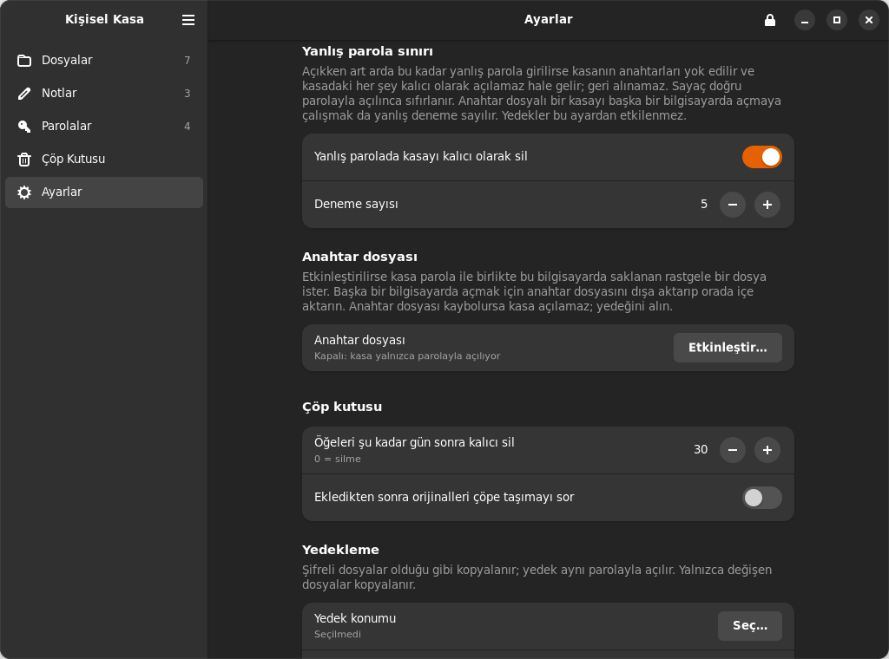
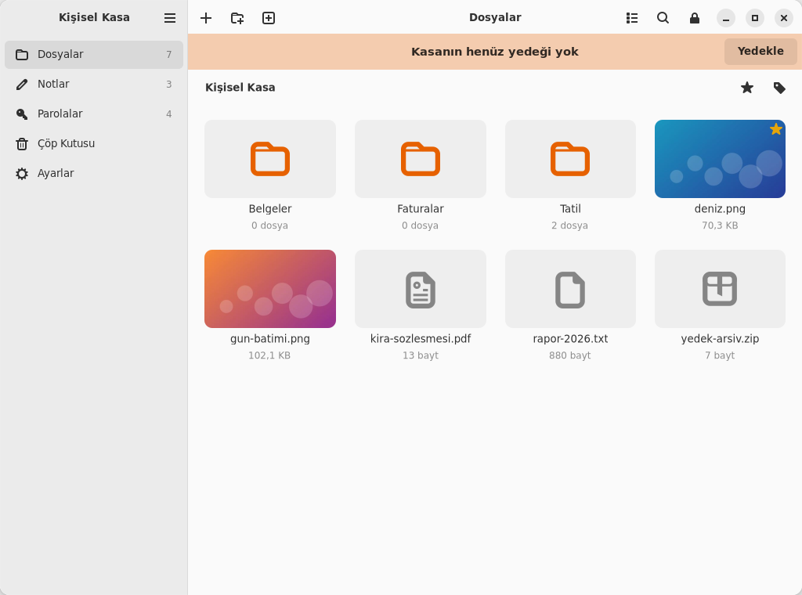

# Mahzen — Linux sürümü

Mahzen'in Linux uygulaması: GTK 4 + libadwaita arayüzü, Python ile yazılmış şifreleme çekirdeği.
**macOS sürümüyle aynı kasa biçimini kullanır.** Bir SSD'deki `Mahzen Kasası` klasörü hem Mac'te hem Linux'ta açılır;
iki uygulama da aynı kasaya dosya, not ve parola ekleyebilir.

<p align="center">
  
</p>

<p align="center">
  
  
</p>
<p align="center">
  
  
</p>
<p align="center">
  
  
</p>

## Kurulum

Gereksinimler: Python 3.10+, GTK 4, **libadwaita 1.5+**, PyGObject, `cryptography`, `argon2-cffi`.
Ubuntu 24.04+, Debian 13+, Fedora 40+, Arch ve openSUSE Tumbleweed'de bunların hepsi dağıtım paketi olarak gelir.

```bash
git clone https://github.com/efefdev/Mahzen.git
cd Mahzen/linux
./install.sh
```

`install.sh` bağımlılıkları dağıtımın paket yöneticisiyle (apt, dnf, pacman, zypper) kurar ve uygulamayı
`~/.local` altına yerleştirir; yönetici parolası yalnızca bağımlılıklar için istenir. Ardından Mahzen uygulama
menüsünde görünür, terminalden de `mahzen` ile açılır. Bağımlılıklar zaten kuruluysa: `./install.sh --no-deps`.
Kaldırmak için `./uninstall.sh` (kasalara ve anahtar dosyalarına dokunmaz).

### Kurmadan, diskten çalıştırma (taşınabilir)

```bash
./mahzen.sh
```

`mahzen.sh` kasayı kendi klasöründe ya da bir üst klasörde `Mahzen Kasası` adıyla arar. Böylece bir SSD'nin kökünde
şöyle bir düzen kurulabilir:

```
SSD/
├── Mahzen.app        macOS uygulaması
├── Mahzen-Linux/     bu klasörün (linux/) kopyası → ./mahzen.sh
└── Mahzen Kasası/    ortak şifreli kasa
```

Linux bilgisayarda yalnızca bağımlılıkların kurulu olması gerekir (`./install.sh` yerine dağıtımın paketleri).

## Özellikler

macOS sürümündeki özelliklerin çoğu Linux'ta da var:

- **Dosyalar:** sürükle-bırak veya dosya seçiciyle ekleme (klasör yapısı korunur), iç içe klasörler, etiketler,
  favoriler, arama, ızgara/liste görünümü, kasa içinde sürükleyerek taşıma, görsel ve metin önizleme,
  geçici açma, dışa aktarma, mükerrer dosya tespiti, ekledikten sonra orijinalleri çöpe taşıma önerisi
- **Notlar:** renkli, sabitlenebilir notlar; yazı tipi ve boyutu ayarlanabilir
- **Parolalar:** hesap, kart, Wi-Fi, sunucu kayıtları; parola üretici ve güç ölçer; kopyalanan parola seçilen süre
  sonunda panodan silinir
- **Güvenlik:** hareketsizlikte, uykuda, ekran kilitlenince ve kasa diski çıkarılınca otomatik kilit;
  isteğe bağlı anahtar dosyası; isteğe bağlı **yanlış parola sınırı** (art arda N yanlış parolada kasa kalıcı olarak
  silinir; Ayarlar'dan açılıp kapatılır, sayı 3–99 arası; ayrıntılar ana [README](../README.md#yanlış-parola-sınırı)'de);
  eski (PBKDF2) kasaları açılışta Argon2id'ye yükseltme
- **Bakım:** çöp kutusu (ayarlanabilir süre), artımlı yedek ve hatırlatma, bütünlük taraması ve yedekten geri yükleme
- **Görünüm:** varsayılan olarak turuncu-siyah; açık / koyu / sistem teması, 9 vurgu rengi (ayarlar kasada saklanır, iki sistemde ortaktır)

### Linux'a özgü farklar

| Konu | Linux'ta |
|---|---|
| Video ve ses | Uygulama içinde oynatılmaz; "Geçici Olarak Aç" ile sistemin oynatıcısında açılır. |
| PDF ve belge önizleme | Aynı şekilde geçici açma ile. Uygulama içi önizleme görseller ve metin dosyaları içindir. |
| Küçük resimler | Yalnızca görseller için üretilir (macOS ayrıca PDF/video için de üretir). |
| Geçici açma | Şifresiz kopya `$XDG_RUNTIME_DIR` altına (oturuma özel, çoğu sistemde bellekte) yazılır; kilitte ve çıkışta silinir. |
| Ekran görüntüsünden gizleme | Wayland/X11'de uygulamalar bunu engelleyemez; bu ayar Linux'ta etkisizdir. |
| Anahtar dosyaları | `~/.local/share/Mahzen/Anahtarlar` (izinler 700/600). Mac'teki anahtar dosyasını taşımak için Mac'te "Dışa aktar", Linux'ta kilit ekranındaki menüden "Anahtar Dosyası İçe Aktar". |

## Test etme (ilk kurulumdan sonra)

Gerçek kasanızla değil, **deneme amaçlı yeni bir kasayla** başlayın:

1. `mahzen` → **Yeni Kasa Oluştur** → konum olarak örneğin `~/Mahzen Deneme` seçin, bir parola belirleyin.
   Kasa oluşturma birkaç saniye sürer (Argon2id 1 GB bellek kullanır).
2. **Dosyalar:** birkaç görsel ve bir klasör sürükleyip bırakın ya da `+` ile ekleyin. Küçük resimler oluşmalı,
   klasör yapısı korunmalı. Bir görsele ve bir `.txt` dosyasına çift tıklayıp önizleyin; birini **Geçici Olarak Aç**,
   birini **Dışa Aktar** ile deneyin.
3. **Notlar ve Parolalar:** bir not ve bir parola kaydı ekleyin; parola üreticiyi ve **Kopyala**'yı deneyin
   (kopyalanan parola 30 sn sonra panodan silinmeli).
4. **Kilit:** `Ctrl+L` ile kilitleyin, yanlış sonra doğru parola girin. Ekran kilidinde/uykuda da kilitlenmeli.
5. **Yanlış parola sınırı:** Ayarlar → *Yanlış parola sınırı*'nı açın, deneme sayısını 3 yapın, kilitleyin ve
   3 kez yanlış parola girin: kasa kalıcı olarak silinmeli. (Bunu yalnızca deneme kasasında yapın!)
6. **macOS ile ortak kasa (isteğe bağlı):** Mac'te oluşturulmuş bir kasayı (ör. SSD'deki `Mahzen Kasası`)
   kilit ekranındaki menüden **Başka Kasa Aç…** ile seçin; Mac'teki dosya, not ve parolalar görünmeli.
   Linux'ta eklediğiniz bir dosya da Mac'te görünmeli.
7. **Yedek ve bakım:** Ayarlar'dan bir yedek konumu seçip **Şimdi Yedekle**, ardından **Bütünlük taraması**.

Bir sorun görürseniz terminalden `mahzen` ile başlatıp çıktıyı da ekleyerek
[bir konu açın](https://github.com/efefdev/Mahzen/issues).

## Komut satırı

Arayüzü olmayan sunucular için `mahzen-cli` (kurulumsuz: `./mahzen.sh cli`):

```bash
mahzen-cli bilgi   "/media/ssd/Mahzen Kasası"              # başlık bilgisi, parola istemez
mahzen-cli listele "/media/ssd/Mahzen Kasası"
mahzen-cli disari  "/media/ssd/Mahzen Kasası" fatura.pdf ~/İndirilenler
mahzen-cli ekle    "/media/ssd/Mahzen Kasası" belge.pdf Fotoğraflar/
mahzen-cli dogrula "/media/ssd/Mahzen Kasası"
mahzen-cli yedekle "/media/ssd/Mahzen Kasası" "/media/yedek/Mahzen Kasası Yedek"
```

Parola her seferinde sorulur (`--parola-stdin` ile standart girdiden okunabilir); anahtar dosyası gerekiyorsa
`--anahtar dosya.mahzenkey`. Yanlış parola sınırı açıksa komut satırındaki yanlış denemeler de sayılır.

## Şifreleme

Çekirdek, macOS'taki `MahzenCore` ile birebir aynıdır (ayrıntılar ana [README](../README.md)'de):
AES-256-GCM (`cryptography`/OpenSSL), Argon2id 1 GB · 3 geçiş · 4 iş parçacığı (`argon2-cffi`, resmi Argon2
uygulaması), HKDF-SHA256 alt anahtarlar, 1 MB'lık parçalara bağlı nonce'lar. Parolalar Unicode NFC biçimine
getirilir; Türkçe karakterli parolalar iki sistemde aynı anahtarı üretir.

Dizin JSON'unda bu sürümün tanımadığı alanlar (macOS'un ileride ekleyeceği alanlar dahil) okunup aynen geri yazılır.

## Testler

```bash
python3 -m unittest discover -s linux/tests
```

`tests/fixtures/` altındaki kasalar macOS sürümüyle oluşturulmuştur (Argon2id, anahtar dosyalı ve eski PBKDF2
kasalar); testler Linux sürümünün bunları açabildiğini doğrular. Ters yönde, `tests/fixtures/python-vault` bu
sürümle oluşturulur ve macOS tarafındaki `swift test` (LinuxCompatibilityTests) onu açar. Biçim değişirse:
`python3 linux/tests/make_python_fixture.py`.

## Proje yapısı

```
linux/
├── mahzen/core/   şifreleme, kasa biçimi, dizin işlemleri, yedekleme (arayüzden bağımsız)
├── mahzen/ui/     GTK 4 / libadwaita arayüzü
├── mahzen/cli.py  komut satırı
├── data/          simgeler ve .desktop dosyası
├── tests/         çekirdek ve uyumluluk testleri
├── install.sh, uninstall.sh, mahzen.sh
```
