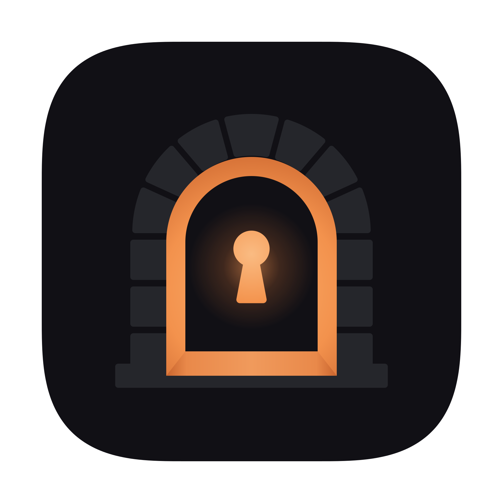
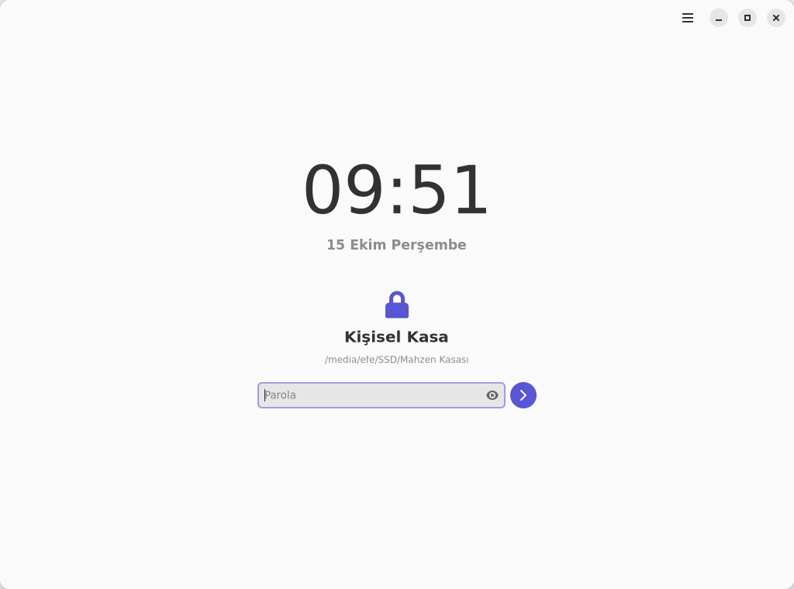
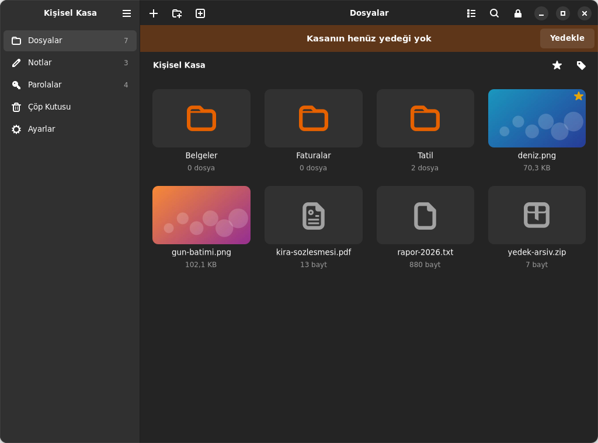
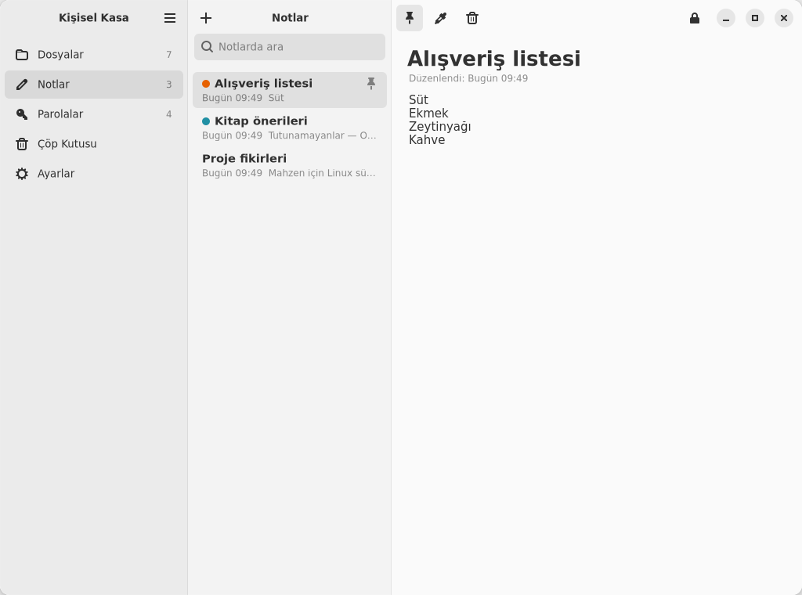
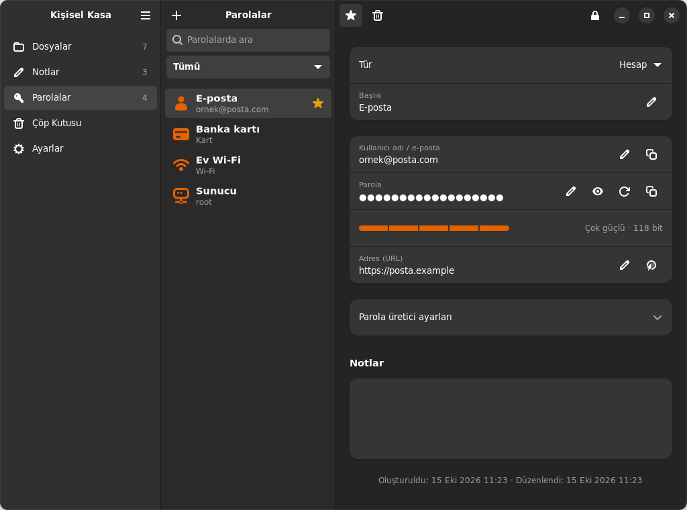
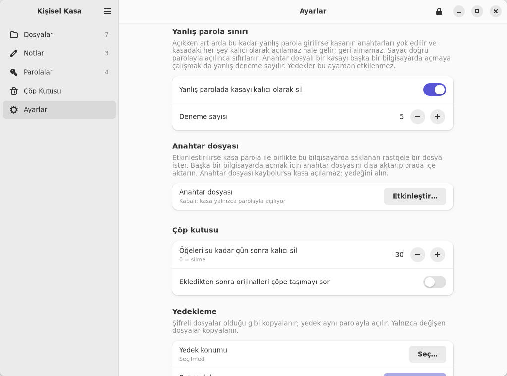
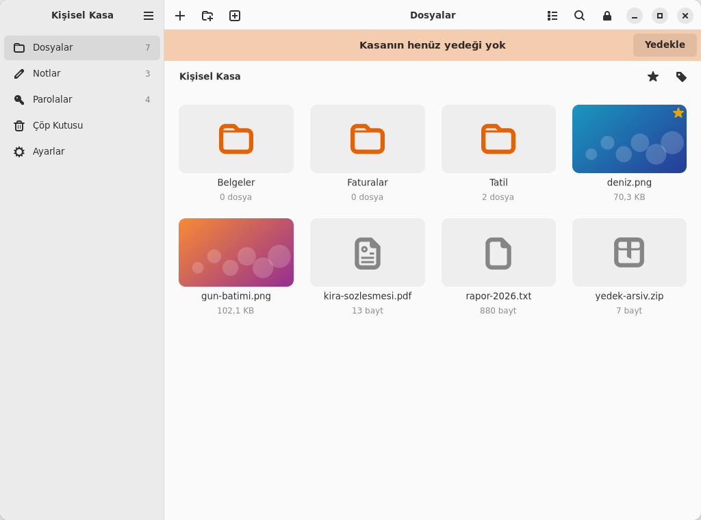

[English](README.md) · **Türkçe**

# Mahzen — Linux sürümü

Mahzen'in Linux uygulaması: GTK 4 + libadwaita arayüzü, Python ile yazılmış şifreleme çekirdeği.
**macOS sürümüyle aynı kasa biçimini kullanır.** Bir SSD'deki `Mahzen Kasası` klasörü hem Mac'te hem Linux'ta açılır;
iki uygulama da aynı kasaya dosya, not ve parola ekleyebilir.

<p align="center">
  
</p>

<p align="center">
  
  
</p>
<p align="center">
  
  
</p>
<p align="center">
  
  
</p>

## Kurulum

Gereksinimler: Python 3.10+, GTK 4, **libadwaita 1.5+**, PyGObject, `cryptography`, `argon2-cffi`.
Ubuntu 24.04+, Debian 13+, Fedora 40+, Arch ve openSUSE Tumbleweed'de bunların hepsi dağıtım paketi olarak gelir.

```bash
git clone https://github.com/efefdev/Mahzen.git
cd Mahzen/linux
./install.sh
```

`install.sh` bağımlılıkları dağıtımın paket yöneticisiyle (apt, dnf, pacman, zypper) kurar ve uygulamayı
`~/.local` altına yerleştirir; yönetici parolası yalnızca bağımlılıklar için istenir. Ardından Mahzen uygulama
menüsünde görünür, terminalden de `mahzen` ile açılır. Bağımlılıklar zaten kuruluysa: `./install.sh --no-deps`.
Kaldırmak için `./uninstall.sh` (kasalara ve anahtar dosyalarına dokunmaz).

### Kurmadan, diskten çalıştırma (taşınabilir)

```bash
./mahzen.sh
```

`mahzen.sh` kasayı kendi klasöründe ya da bir üst klasörde `Mahzen Kasası` adıyla arar. Böylece bir SSD'nin kökünde
şöyle bir düzen kurulabilir:

```
SSD/
├── Mahzen.app        macOS uygulaması
├── Mahzen-Linux/     bu klasörün (linux/) kopyası → ./mahzen.sh
└── Mahzen Kasası/    ortak şifreli kasa
```

Linux bilgisayarda yalnızca bağımlılıkların kurulu olması gerekir (`./install.sh` yerine dağıtımın paketleri).

## Özellikler

macOS sürümündeki özelliklerin çoğu Linux'ta da var:

- **Dosyalar:** sürükle-bırak veya dosya seçiciyle ekleme (klasör yapısı korunur), iç içe klasörler, etiketler,
  favoriler, arama, ızgara/liste görünümü, kasa içinde sürükleyerek taşıma, görsel ve metin önizleme
  (← / → tuşları ya da yatay kaydırmayla önceki/sonraki dosya, "n / toplam" sayacı), ızgarada boş alandan
  sürükleyerek dikdörtgenle toplu seçim (Ctrl/Shift ile mevcut seçime ekler; kenara gelince ızgara kendiliğinden
  kayar), geçici açma, dışa aktarma, mükerrer dosya tespiti, ekledikten sonra orijinalleri çöpe taşıma önerisi
- **Telefonda Göster:** seçili fotoğraf ve videoları ya da bir klasörü aynı Wi-Fi'deki telefonda QR kodla,
  uçtan uca şifreli gösterir (aşağıda)
- **Telefondan Ekle:** tersi; telefonun tarayıcısında seçilen dosyalar telefonda şifrelenip açık klasöre eklenir
  (aşağıda)
- **Notlar:** renkli, sabitlenebilir notlar; yazı tipi ve boyutu ayarlanabilir
- **Parolalar:** hesap, kart, Wi-Fi, sunucu kayıtları; parola üretici ve güç ölçer; kopyalanan parola seçilen süre
  sonunda panodan silinir
- **Güvenlik:** hareketsizlikte, uykuda, ekran kilitlenince ve kasa diski çıkarılınca otomatik kilit;
  isteğe bağlı anahtar dosyası; isteğe bağlı **yanlış parola sınırı** (art arda N yanlış parolada kasa kalıcı olarak
  silinir; Ayarlar'dan açılıp kapatılır, sayı 3–99 arası; ayrıntılar ana [README](../README.tr.md#yanlış-parola-sınırı)'de);
  eski (PBKDF2) kasaları açılışta Argon2id'ye yükseltme
- **Bakım:** çöp kutusu (ayarlanabilir süre), artımlı yedek ve hatırlatma, bütünlük taraması ve yedekten geri yükleme
- **Görünüm:** varsayılan olarak turuncu-siyah; açık / koyu / sistem teması, 9 vurgu rengi (ayarlar kasada saklanır, iki sistemde ortaktır)
- **Dil:** Sistem / Türkçe / English, Ayarlar'dan seçilir (sistem dili Türkçe değilse uygulama İngilizce açılır)

### Telefonda Göster

Fotoğraf/video seçip sağ tıklayın (ya da seçim çubuğundaki telefon düğmesi) → **Telefonda Göster…**; bir klasörde
aynı komut klasörü alt klasörleriyle birlikte gösterir. Açılan penceredeki QR kodu telefonun kamerasıyla okutun.
Telefonda ızgara, tam ekran, kaydırma, yakınlaştırma ve video oynatma sunan bir sayfa açılır; uygulama kurmak gerekmez.

- **Uçtan uca şifreli:** dosyalar her paylaşım için üretilen 256 bitlik bir anahtarla (ChaCha20-Poly1305) şifreli
  gider. Anahtar yalnızca QR koddaki adresin `#` kısmındadır; tarayıcı bu kısmı sunucuya göndermez, ağda yalnızca
  şifreli bayt dolaşır. Dosya adları da şifreli listeyle gider. Şifre çözme telefondaki tarayıcıda yapılır.
- **Yalnızca yerel ağ:** bilgisayar, Wi-Fi (ya da kablolu) yerel adresinde rastgele bir portta dinler; internete
  çıkmaz. Adres tahmin edilemeyen bir jeton içerir, başka her istek reddedilir.
- **Süreli:** paylaşım 10 dakika sonra, **Durdur**'a basınca, pencere kapanınca ya da kasa kilitlenince hemen kapanır.
  Telefondaki sayfa paylaşım bitince çözülmüş içeriği siler. Pencerede kalan süre ve bağlanan cihaz sayısı görünür.
- Akış biçimi ve telefon sayfası macOS sürümüyle aynıdır.
- **Sanal makinede:** Linux bir sanal makinede NAT ağıyla (VirtualBox, UTM, VMware, Parallels, virt-manager ve WSL2'nin
  varsayılanı) çalışıyorsa adres ana bilgisayarın içindeki özel bir ağda kalır ve telefon ulaşamaz. Mahzen bu durumu
  algılayıp paylaşım penceresinde uyarır. Çözüm: sanal makinenin ağını köprü (bridged) moduna almak; WSL2'de
  `.wslconfig` içinde `networkingMode=mirrored`.

Telefon sayfayı açamıyorsa: iki cihaz aynı ağda mı, ağ "misafir/istemci yalıtımı" kullanıyor mu, bilgisayarın
güvenlik duvarı gelen bağlantıları engelliyor mu bakın (ör. `ufw` açıksa geçici olarak yerel ağdan gelen
bağlantılara izin verin; Fedora'nın varsayılan *FedoraWorkstation* bölgesi yüksek portlara zaten izin verir).

### Telefondan Ekle

Dosyalar başlığındaki **+** düğmesinin yanındaki ok → **Telefondan Ekle…** (dosyalar açık olan klasöre gider) ya da bir
klasöre sağ tıklayıp **Telefondan Ekle…**. QR kodu telefonun kamerasıyla okutun; açılan sayfada **Fotoğraf, video ya da
dosya seç**'e dokunun. Pencere gelen her dosyayı listeler.

- **Telefonda şifrelenir:** her dosya, telefonun tarayıcısında QR koddaki 256 bitlik oturum anahtarıyla şifrelenir
  (Telefonda Göster ile aynı ChaCha20-Poly1305 akış biçimi) ve parça parça gönderilir. Bilgisayar her parçayı bellekte
  doğrulayıp çözer ve doğrudan kasaya şifreler; şifresiz kopya hiçbir an diske yazılmaz. Dosya adları da şifreli gider.
- **Yarıda kesilebilir:** dosya başına en fazla 8 GB. Telefonda iptal edilen, yarıda kesilen ya da 90 saniye veri
  göndermeyen dosya bırakılır ve yarım şifreli dosyası silinir. Kasada zaten olan dosya yeniden eklenmez. Diske yalnızca
  oturum anahtarıyla doğrulanan baytlar yazılır.
- **Yalnızca yerel ağ, süreli:** Telefonda Göster ile aynı (rastgele port, tahmin edilemez jeton, 10 dakika; **Durdur**,
  pencereyi kapatma ya da kilitlenmeyle biter). Sanal makine uyarısı burada da geçerlidir.
- Yükleme bitene kadar sayfayı telefonda açık tutun; ekranı kilitlenen telefon tarayıcıyı duraklatır.
- Görsellerin küçük resmi kasadaki kopyadan bellekte üretilir.

### Linux'a özgü farklar

| Konu | Linux'ta |
|---|---|
| Video ve ses | Uygulama içinde oynatılmaz; "Geçici Olarak Aç" ile sistemin oynatıcısında açılır. |
| PDF ve belge önizleme | Aynı şekilde geçici açma ile. Uygulama içi önizleme görseller ve metin dosyaları içindir. |
| Küçük resimler | Yalnızca görseller için üretilir (macOS ayrıca PDF/video için de üretir). |
| Geçici açma | Şifresiz kopya `$XDG_RUNTIME_DIR` altına (oturuma özel, çoğu sistemde bellekte) yazılır; kilitte ve çıkışta silinir. |
| Ekran görüntüsünden gizleme | Wayland/X11'de uygulamalar bunu engelleyemez; bu ayar Linux'ta etkisizdir. |
| Anahtar dosyaları | `~/.local/share/Mahzen/Anahtarlar` (izinler 700/600). Mac'teki anahtar dosyasını taşımak için Mac'te "Dışa aktar", Linux'ta kilit ekranındaki menüden "Anahtar Dosyası İçe Aktar". |

## Test etme (ilk kurulumdan sonra)

Gerçek kasanızla değil, **deneme amaçlı yeni bir kasayla** başlayın:

1. `mahzen` → **Yeni Kasa Oluştur** → konum olarak örneğin `~/Mahzen Deneme` seçin, bir parola belirleyin.
   Kasa oluşturma birkaç saniye sürer (Argon2id 1 GB bellek kullanır).
2. **Dosyalar:** birkaç görsel ve bir klasör sürükleyip bırakın ya da `+` ile ekleyin. Küçük resimler oluşmalı,
   klasör yapısı korunmalı. Bir görsele ve bir `.txt` dosyasına çift tıklayıp önizleyin; birini **Geçici Olarak Aç**,
   birini **Dışa Aktar** ile deneyin.
3. **Notlar ve Parolalar:** bir not ve bir parola kaydı ekleyin; parola üreticiyi ve **Kopyala**'yı deneyin
   (kopyalanan parola 30 sn sonra panodan silinmeli).
4. **Kilit:** `Ctrl+L` ile kilitleyin, yanlış sonra doğru parola girin. Ekran kilidinde/uykuda da kilitlenmeli.
5. **Yanlış parola sınırı:** Ayarlar → *Yanlış parola sınırı*'nı açın, deneme sayısını 3 yapın, kilitleyin ve
   3 kez yanlış parola girin: kasa kalıcı olarak silinmeli. (Bunu yalnızca deneme kasasında yapın!)
6. **macOS ile ortak kasa (isteğe bağlı):** Mac'te oluşturulmuş bir kasayı (ör. SSD'deki `Mahzen Kasası`)
   kilit ekranındaki menüden **Başka Kasa Aç…** ile seçin; Mac'teki dosya, not ve parolalar görünmeli.
   Linux'ta eklediğiniz bir dosya da Mac'te görünmeli.
7. **Yedek ve bakım:** Ayarlar'dan bir yedek konumu seçip **Şimdi Yedekle**, ardından **Bütünlük taraması**.
8. **Önizlemede gezinme ve toplu seçim:** bir görseli önizleyip ← / → ile (ya da dokunmatik yüzeyde iki parmakla
   yatay kaydırarak) diğer dosyalara geçin; başlıktaki sayaç "n / toplam" göstermeli. Izgarada boş bir yerden
   sürükleyerek birkaç öğeyi dikdörtgenle seçin, Ctrl basılıyken bir dikdörtgen daha çizip seçime ekleyin;
   pencerenin altına doğru sürüklerken ızgara kendiliğinden kaymalı.
9. **Telefonda Göster:** birkaç görsel seçip sağ tık → **Telefonda Göster…**; QR kodu aynı Wi-Fi'deki telefonla
   okutun. Görseller telefonda açılmalı, penceredeki cihaz sayısı artmalı; **Durdur**'dan sonra en geç yarım
   dakika içinde telefondaki sayfa paylaşımın kapandığını göstermeli ve içeriği silmeli.
10. **Telefondan Ekle:** bir klasör açıp **+** yanındaki ok → **Telefondan Ekle…**; QR kodu okutup telefonda birkaç
    fotoğraf ve bir video seçin. Her dosya penceredeki listede ve klasörde görünmeli (görseller küçük resimle); aynı
    fotoğrafı yeniden seçince "Kasada zaten vardı" yazmalı; büyük bir videoyu telefonda iptal edince yeni dosya
    kalmamalı.

Bir sorun görürseniz terminalden `mahzen` ile başlatıp çıktıyı da ekleyerek
[bir konu açın](https://github.com/efefdev/Mahzen/issues).

## Komut satırı

Arayüzü olmayan sunucular için `mahzen-cli` (kurulumsuz: `./mahzen.sh cli`):

```bash
mahzen-cli bilgi   "/media/ssd/Mahzen Kasası"              # başlık bilgisi, parola istemez
mahzen-cli listele "/media/ssd/Mahzen Kasası"
mahzen-cli disari  "/media/ssd/Mahzen Kasası" fatura.pdf ~/İndirilenler
mahzen-cli ekle    "/media/ssd/Mahzen Kasası" belge.pdf Fotoğraflar/
mahzen-cli dogrula "/media/ssd/Mahzen Kasası"
mahzen-cli yedekle "/media/ssd/Mahzen Kasası" "/media/yedek/Mahzen Kasası Yedek"
```

Parola her seferinde sorulur (`--parola-stdin` ile standart girdiden okunabilir); anahtar dosyası gerekiyorsa
`--anahtar dosya.mahzenkey`. Yanlış parola sınırı açıksa komut satırındaki yanlış denemeler de sayılır.

## Şifreleme

Çekirdek, macOS'taki `MahzenCore` ile birebir aynıdır (ayrıntılar ana [README](../README.tr.md)'de):
AES-256-GCM (`cryptography`/OpenSSL), Argon2id 1 GB · 3 geçiş · 4 iş parçacığı (`argon2-cffi`, resmi Argon2
uygulaması), HKDF-SHA256 alt anahtarlar, 1 MB'lık parçalara bağlı nonce'lar. Parolalar Unicode NFC biçimine
getirilir; Türkçe karakterli parolalar iki sistemde aynı anahtarı üretir.

Dizin JSON'unda bu sürümün tanımadığı alanlar (macOS'un ileride ekleyeceği alanlar dahil) okunup aynen geri yazılır.

## Testler

```bash
python3 -m unittest discover -s linux/tests
```

`tests/fixtures/` altındaki kasalar macOS sürümüyle oluşturulmuştur (Argon2id, anahtar dosyalı ve eski PBKDF2
kasalar); testler Linux sürümünün bunları açabildiğini doğrular. Ters yönde, `tests/fixtures/python-vault` bu
sürümle oluşturulur ve macOS tarafındaki `swift test` (LinuxCompatibilityTests) onu açar. Biçim değişirse:
`python3 linux/tests/make_python_fixture.py`.

`tests/test_phoneshare.py` Telefonda Göster'i sınar: şifreli akışın macOS sürümüyle bayt bayt aynı olduğunu
(sabit anahtarlı çapraz denetim), gerçek bir kasadan yerel sunucuya HTTP istekleriyle uçtan uca aktarımı, güvenlik
başlıklarını, jeton ve süre denetimini, QR üreticisini ve Node.js kuruluysa telefon sayfasındaki JavaScript
çözücünün Python akışını açtığını. macOS testinin yazdığı akış da verilebilir:
`MAHZEN_PHONE_FIXTURE=/yol/onek swift test --filter PhoneShareTests` sonra aynı değişkenle Python testleri.

`tests/test_phoneupload.py` Telefondan Ekle'yi sınar: parça parça çözücüyü ve kasaya akışla yazıcıyı (normal içe
aktarmayla bayt bayt aynı), yükleme alıcısının reddettiği durumları (yanlış anahtar, boyut sınırı, disk alanı, sıra,
değiştirme, kesilme) ve temizliği, iptal ve yarıda kesilen isteklerle birlikte yerel sunucuya HTTP üzerinden uçtan uca
yüklemeyi ve Node.js kuruluysa telefon sayfasındaki JavaScript şifreleyicinin ürettiği akışın Python'da açıldığını (aynı
sabit anahtarlı değerler Swift'te de denetlenir). `MAHZEN_UPLOAD_FIXTURE=/yol/onek` tarayıcının akışını
`swift test --filter PhoneUploadTests` için yazar.
Telefon sayfaları (`mahzen/core/phone_viewer.html`, `mahzen/core/phone_upload.html`) macOS kaynağından aktarılır;
macOS'ta bir sayfa değişirse: `python3 linux/tests/sync_phone_viewer.py`.

## Proje yapısı

```
linux/
├── mahzen/core/   şifreleme, kasa biçimi, dizin işlemleri, yedekleme (arayüzden bağımsız)
├── mahzen/ui/     GTK 4 / libadwaita arayüzü
├── mahzen/cli.py  komut satırı
├── data/          simgeler ve .desktop dosyası
├── tests/         çekirdek ve uyumluluk testleri
├── install.sh, uninstall.sh, mahzen.sh
```
